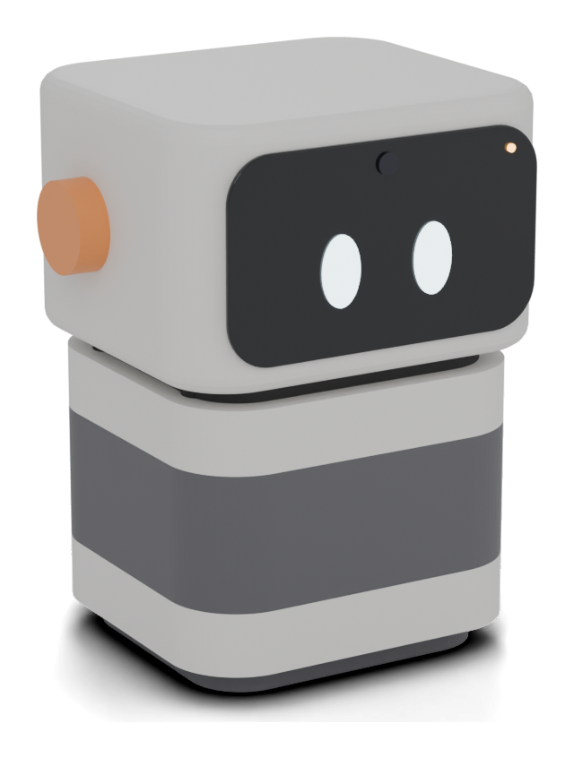
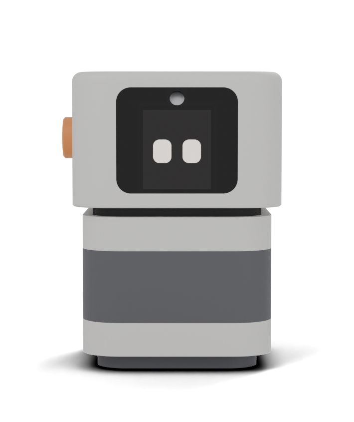
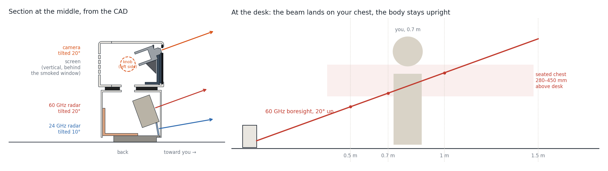
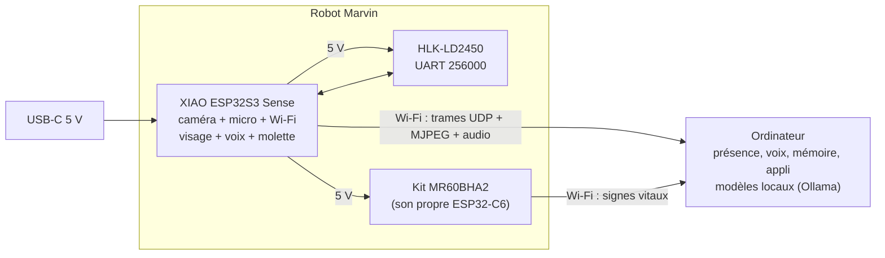

# Marvin

**Un petit compagnon de bureau qui perçoit la pièce de quatre façons à la fois, et qui sait comment tu vas.**

Marvin est un robot open source pour ton bureau. Une caméra et un visage vivent derrière une vitre noire dans sa tête, et deux radars millimétriques (24 GHz et 60 GHz) se cachent derrière la bande qui fait le tour de son corps. Il t'entend grâce à un micro et te répond par un haut-parleur sur le côté.

Il peut **voir** (caméra), **ressentir** (qui est dans la pièce, comment on bouge, et ta respiration et ton rythme cardiaque quand tu es assis devant), **écouter** (micro) et **parler** (haut-parleur, yeux expressifs). Le gros du calcul tourne sur ton ordinateur, avec des modèles locaux uniquement : pas de cloud, pas de compte.

<p align="center">
  
  
</p>

> English: [read in English](README.md) · Toute la documentation (en anglais), dans l'ordre de lecture : [docs/README.md](docs/README.md) · Page de présentation (FR/EN) : ouvre [`docs/index.html`](docs/index.html) dans un navigateur.

> **État du projet (14 octobre 2026) : rév. F, le premier exemplaire se prépare ; rien n'est encore monté.** La moitié basse de la CAO est dessinée et imprimable ([`hardware/cad/marvin.scad`](hardware/cad/marvin.scad)) : corps, socle, support des radars et cou en TPU ; la tête suivra une fois l'écran mesuré. Le firmware est écrit et testé sur l'ordinateur et en simulation ; son code pour les vrais capteurs, l'écran, l'audio et la caméra attend la première mise sous tension, d'abord sur breadboard ([le banc XIAO](docs/xiao-bench.md)). Le logiciel côté ordinateur tourne déjà sur un Mac : événements de présence, l'appli, la voix locale, la mémoire, les tâches de fond ([le lancer](docs/getting-started.md)). Le travail vers **Marvin v1** (te saluer par ton prénom, un rythme cardiaque fiable, l'Âme, Google Agenda et les brouillons Gmail, une première configuration guidée) se termine quand la [liste de recette v1](docs/test-plan.md) passe sur le vrai robot. Depuis le 14 octobre 2026, Marvin n'a plus de lidar. Le phare de la rév. E est archivé dans [`hardware/archive/rev-e/`](hardware/archive/rev-e/).

## Ce qu'on veut faire

Chaque capteur, seul, est à moitié aveugle. Un radar sait qui bouge et qui respire, mais ne voit pas à quoi ressemblent les gens. Une caméra voit tout et ne comprend rien aux distances ni à la respiration. Marvin les réunit dans un petit corps, sur une même horloge, et donne une personnalité au résultat.

1. **Capter : le robot est bête exprès.** L'ESP32-S3 lit chaque capteur, horodate chaque paquet avec la même horloge et l'envoie en Wi-Fi. Il dessine ses propres yeux et joue ses propres sons.
2. **Fusionner : l'ordinateur réfléchit.** Il place chaque mesure dans un même repère (les personnes et leurs vitesses vues par le radar, les signes vitaux, la caméra quand tu lui demandes de regarder) et en tire des événements de présence : tu es arrivé, tu t'es assis, tu es immobile depuis longtemps.
3. **Vivre : un compagnon qui remarque.** Il te salue par ton prénom quand tu t'assois, te rappelle de faire une pause après une cinquantaine de minutes assis, affiche ta respiration et ton rythme cardiaque (mesurés, pas diagnostiqués), répond à tes questions en français ou en anglais avec ce que lui disent ses capteurs et ce dont il se souvient de toi (chaque souvenir montre d'où il vient, et tu peux le corriger ou le faire oublier), et travaille en arrière-plan sur des tâches plus longues. Il lit ton agenda et peut écrire des brouillons d'e-mails, jamais les envoyer. Tout tourne sur ton ordinateur et aucune image ne quitte la pièce ; la seule exception, optionnelle, est l'outil météo, qui envoie un nom de lieu à Open-Meteo et peut être désactivé.

## Pensé autour des capteurs

Le robot se tient droit sur le bureau ; **ce sont les capteurs qui sont inclinés à l'intérieur**, pas le corps.

- **Le cœur, au bureau.** Le radar 60 GHz est dans le corps, sur un support incliné de 20° vers le haut, pour que son faisceau tombe sur la poitrine d'une personne assise à 0,65–1,1 m. Il regarde à travers une paroi plate de 1,6 mm en PETG, une demi-longueur d'onde à 60 GHz ; la traverser à 20° ne coûte presque rien.
- **Suivre la pièce.** Le radar 24 GHz est juste en dessous, incliné de 10°, et couvre ±60° de la pièce. En dessous et pas au-dessus : il ne masque jamais le faisceau du 60 GHz.
- **Visage et caméra.** L'écran reste vertical derrière une vitre en acrylique fumé ; la caméra est inclinée de 20° pour cadrer ton visage, pas ta poitrine.
- **Silence pour le radar.** La tête et le corps sont reliés par un amortisseur en TPU : un choc sur la tête ou un appui sur la molette ne secoue pas le radar du cœur.
- **Compact.** Environ 88 × 80 mm au sol, environ 12,5 cm de haut.

<p align="center">
  
</p>

## Ce qu'apporte chaque pièce

| Pièce | Bande | Son rôle |
|---|---|---|
| Hi-Link **HLK-LD2450** | Radar 24 GHz | Position et vitesse de 3 personnes au plus, jusqu'à 6 m |
| Kit Seeed **MR60BHA2** | Radar 60 GHz | Présence, rythme respiratoire et rythme cardiaque, au mieux à moins d'1 m |
| **XIAO ESP32S3 Sense** | Lumière visible | Caméra, micro, Wi-Fi, et le cerveau qui fait tout tourner |
| Module **LCD 1,69"** (ST7789, 240 × 280) | — | Le visage : des yeux expressifs |
| Ampli **MAX98357A** + haut-parleur 1 W | Son | La voix : sons intégrés, et réponses parlées venues de l'ordinateur |
| Un bouton poussoir 6 × 6 mm | — | La molette orange : un appui pour parler, un appui long pour couper le micro |

La mesure du cœur par radar est de niveau grand public : quelques battements par minute d'erreur, et seulement si tu restes à peu près immobile. Ce n'est pas un appareil médical.

## Style

Coque gris chaud, bande et visage anthracite, une seule molette orange : un appui et Marvin écoute, un appui long coupe le micro (le volume se règle dans l'appli). Pas d'autocollants, pas de traits de dessin animé : la personnalité passe par les yeux et par le comportement.

Son nom sert aussi à le réveiller : « Marvin, … » au début ou à la fin d'une phrase. L'ordinateur trouve le nom dans ce qu'il transcrit, qu'il soit prononcé à la française ou à l'anglaise ; pas de modèle de mot-clé, c'est voulu ([voice.md](docs/voice.md#the-wake-word-no-keyword-model-on-purpose)).

## Comment ça marche



Voir [docs/architecture.md](docs/architecture.md) pour les débits, le budget d'alimentation et la raison de chaque choix, et [docs/design.md](docs/design.md) pour la conception du logiciel côté ordinateur.

## Le construire

Les tutoriels, dans l'ordre ([docs/README.md](docs/README.md), en anglais) :

1. **Lancer le logiciel sur ton Mac**, avec un robot simulé, puis avec un modèle local : [docs/getting-started.md](docs/getting-started.md). Aucun matériel nécessaire : `./marvin demo`, puis `./marvin up`.
2. **Acheter les pièces** de [docs/bom.md](docs/bom.md) : environ 115 €.
3. **Essayer l'électronique sur breadboard**, avec un auto-test au démarrage qui dit ce qui répond : [docs/xiao-bench.md](docs/xiao-bench.md).
4. **Imprimer** en suivant [docs/printing.md](docs/printing.md). Les pièces du corps sont prêtes ; celles de la tête arrivent avec la CAO de la tête.
5. **Souder** deux barrettes de broches, puis **câbler** les 27 connexions de [docs/wiring.md](docs/wiring.md). Le guide est écrit pour les débutants. Trois règles : fie-toi au nom imprimé sur la carte, pas à la couleur du fil ; le 5 V ne va jamais sur une broche D0–D10 ; branche l'alimentation en dernier.
6. **Assembler** en suivant [docs/assembly.md](docs/assembly.md), et **flasher** le [firmware](firmware/README.md).
7. **Vérifier** avec la [liste de recette v1](docs/test-plan.md), environ 30 minutes.

Pas encore de carte ? Un radar sur un adaptateur USB-série branché à l'ordinateur s'affiche dans l'appli avec `./marvin up` seul : [docs/usb-sensors.md](docs/usb-sensors.md).

## Organisation du dépôt

```
marvin/
├── marvin                        # le lanceur : ./marvin up, demo, down, status, logs, doctor
├── hardware/
│   ├── cad/                      # source OpenSCAD paramétrique (marvin.scad, rév. F)
│   ├── stl/                      # STL prêts à imprimer (générés)
│   ├── bambu/                    # projet Bambu Studio, A1 + AMS lite (généré)
│   ├── blender/                  # modèle assemblé + plateaux d'impression (générés)
│   ├── scripts/                  # export_stl.sh, render_previews.sh, section_diagram.py, build_3mf.py, build_blend.sh
│   └── archive/                  # révisions précédentes (rév. E : Fanou le phare)
├── firmware/                     # firmware ESP32 : le robot, les bancs, la passerelle MR60BHA2
├── host-java/                    # le logiciel côté ordinateur (Java) : ./marvin le lance
├── host/                         # Python : la voix (sidecar), le simulateur, le visualiseur, les rejeux
├── docs/                         # tutoriels et référence, dans l'ordre de lecture dans docs/README.md
│   ├── getting-started.md        # tutoriel 1 : lancer Marvin sur ton Mac
│   ├── test-plan.md              # la liste de recette v1
│   ├── design.md                 # la conception : mémoire, agents, connecteurs, Âme ; le journal des décisions
│   ├── concepts/                 # études de design, du phare au robot
│   └── index.html                # page de présentation (à ouvrir dans un navigateur)
└── LICENSES/                     # textes complets des licences
```

## Licences

| Quoi | Licence |
|---|---|
| Matériel (`hardware/`) | [CERN-OHL-P-2.0](LICENSES/CERN-OHL-P-2.0.txt) |
| Logiciel (`firmware/`, `host/`, `host-java/`, scripts) | [MIT](LICENSES/MIT.txt) |
| Documentation et images (`docs/`, README) | [CC BY 4.0](LICENSES/CC-BY-4.0.txt) |

Les trois sont permissives : construis-le, modifie-le, vends-le. Garde simplement l'attribution.

## Contribuer

Les issues et les pull requests sont les bienvenues. Les comptes rendus de montage avec photos sont particulièrement utiles tant qu'aucun exemplaire n'a été construit. Voir [CONTRIBUTING.md](CONTRIBUTING.md).

## Crédits

Les dimensions mécaniques viennent de la documentation du module LCD 1,69", du manuel du Hi-Link HLK-LD2450, de la fiche technique et du schéma du Seeed MR60BHA2, et de la documentation du Seeed XIAO ESP32S3 Sense. Les noms des capteurs sont des marques de leurs propriétaires respectifs. Ce projet n'est affilié à aucun d'eux.
