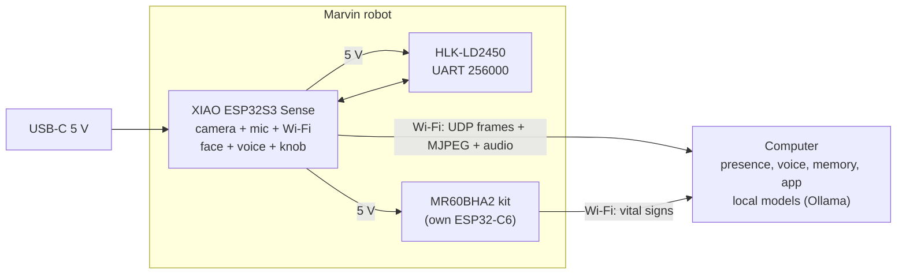

# Marvin

**A small desk companion that senses the room four ways at once, and knows how you are doing.**

Marvin is an open-source robot for your desk. A camera and a face live behind a black glass window in its head, and two mmWave radars (24 GHz and 60 GHz) hide behind the band around its body. It hears you through a microphone and answers through a speaker in its side.

It can **see** (camera), **feel** (who is in the room, how they move, and your breathing and heart rate when you sit in front of it), **hear** (microphone) and **speak** (speaker, expressive eyes). The heavy thinking runs on your computer, with local models only: no cloud, no account.

<p align="center">
  
  
</p>

> Français : [lire en français](README.fr.md) · All the documentation, in reading order: [docs/README.md](docs/README.md) · Presentation page: open [`docs/index.html`](docs/index.html) in a browser.

> **Project status (14 October 2026): rev F, the first build is being prepared; nothing is assembled yet.** The body half of the CAD is designed and printable ([`hardware/cad/marvin.scad`](hardware/cad/marvin.scad)): body, plinth, sensor sled and TPU neck; the head follows once the screen is measured. The firmware is written and tested on the computer and in simulation; its real sensor, screen, audio and camera code waits for the first power-on, on a breadboard first ([the XIAO bench](docs/xiao-bench.md)). The host software runs today on a Mac: presence events, the app, the local voice, memory, background tasks ([run it](docs/getting-started.md)). The work toward **Marvin v1** (greeting you by name, trustworthy heart rate, the Soul, Google Calendar and Gmail drafts, a first-run setup) ends when the [v1 acceptance checklist](docs/test-plan.md) passes on the real robot. Since 14 October 2026 Marvin has no lidar. The rev E lighthouse is archived in [`hardware/archive/rev-e/`](hardware/archive/rev-e/).

## What we want to do

Every sensor on its own is half-blind. A radar knows who moves and who breathes, but it cannot see what they look like. A camera sees everything and understands nothing about distance or breathing. Marvin puts them in one small body, on one clock, and gives the result a personality.

1. **Capture: the robot is dumb on purpose.** The ESP32-S3 reads every sensor, stamps each packet with the same clock and streams it over Wi-Fi. It draws its own eyes and plays its own sounds.
2. **Fuse: the computer does the thinking.** It places every measurement in the same frame (radar people and speeds, vital signs, the camera when you ask it to look) and turns it into presence events: you came in, you sat down, you have been still for a long time.
3. **Live: a companion that notices.** It greets you by name when you sit down, reminds you to take a break after about 50 minutes seated, shows your breathing and heart rate (measured, not diagnosed), answers your questions in French or English with what its sensors tell it and what it remembers of you (every memory shows where it comes from, and you can correct or forget it), and works on longer tasks in the background. It reads your calendar and can write email drafts, never send them. Everything runs on your computer and no image leaves the room; the one optional exception is the weather tool, which sends a place name to Open-Meteo and can be switched off.

## Designed around the sensors

The robot stands upright on the desk; **the sensors are tilted inside it**, not the body.

- **Heart rate at the desk.** The 60 GHz radar sits in the body on a sled tilted 20° up, so its beam lands on the chest of someone seated 0.65–1.1 m away. It looks through a flat 1.6 mm PETG wall, half a wavelength at 60 GHz; crossing it at 20° costs almost nothing.
- **Room tracking.** The 24 GHz radar sits just below it, tilted 10°, covering ±60° of the room. Below, not above: that way it never shadows the 60 GHz beam.
- **Face and camera.** The screen stands vertical behind a smoked acrylic window; the camera is tilted 20° so it frames your face, not your chest.
- **Quiet for the radar.** Head and body are joined through a TPU damper, so a knock on the head or a press on the knob does not shake the heart-rate radar.
- **Compact.** About 88 × 80 mm on the desk, about 12.5 cm tall.

<p align="center">
  
</p>

## What each part adds

| Part | Band | Its role |
|---|---|---|
| Hi-Link **HLK-LD2450** | 24 GHz radar | Position and speed of up to 3 people, up to 6 m |
| Seeed **MR60BHA2** kit | 60 GHz radar | Presence, breathing rate and heart rate, best within 1 m |
| **XIAO ESP32S3 Sense** | Visible light | Camera, microphone, Wi-Fi, and the brain that runs everything |
| **1.69" LCD** module (ST7789, 240 × 280) | — | The face: expressive eyes |
| **MAX98357A** amp + 1 W speaker | Sound | The voice: built-in sounds, and spoken answers from the computer |
| A 6 × 6 mm push button | — | The orange knob: tap to talk, hold to mute |

Heart rate from a radar is consumer-grade: a few beats per minute of error, and only while you stay fairly still. It is not a medical device.

## Design language

Warm grey shell, anthracite band and face, a single orange knob: tap it and Marvin listens, hold it to mute the microphone (the volume is set in the app). No stickers, no cartoon features: the personality comes from the eyes and from how it behaves.

The name is also how you wake it: "Marvin, ..." at the start or the end of a sentence. The computer finds the name in what it transcribes, in French and English spellings alike; there is no keyword model, on purpose ([voice.md](docs/voice.md#the-wake-word-no-keyword-model-on-purpose)).

## How it works



See [docs/architecture.md](docs/architecture.md) for data rates, the power budget and the reasoning behind each choice, and [docs/design.md](docs/design.md) for the host's design.

## Build it

The tutorials, in order ([docs/README.md](docs/README.md)):

1. **Run the host on your Mac**, with a simulated robot, then with a local model: [docs/getting-started.md](docs/getting-started.md). No hardware needed: `./marvin demo`, then `./marvin up`.
2. **Buy the parts** in [docs/bom.md](docs/bom.md): about €115.
3. **Try the electronics on a breadboard**, with a boot self-test that says what answers: [docs/xiao-bench.md](docs/xiao-bench.md).
4. **Print** following [docs/printing.md](docs/printing.md). The body parts are ready to print; the head parts arrive with the head CAD.
5. **Solder** two header strips, then **wire** the 27 connections in [docs/wiring.md](docs/wiring.md). The guide is written for first-timers.
6. **Assemble** following [docs/assembly.md](docs/assembly.md), and **flash** the [firmware](firmware/README.md).
7. **Check it** with the [v1 acceptance checklist](docs/test-plan.md), about 30 minutes.

No board yet? A radar on a USB-serial adapter plugged into the computer shows in the app with `./marvin up` alone: [docs/usb-sensors.md](docs/usb-sensors.md).

## Repository layout

```
marvin/
├── marvin                        # the launcher: ./marvin up, demo, down, status, logs, doctor
├── hardware/
│   ├── cad/                      # parametric OpenSCAD source (marvin.scad, rev F)
│   ├── stl/                      # print-ready STLs (generated)
│   ├── bambu/                    # Bambu Studio project, A1 + AMS lite (generated)
│   ├── blender/                  # assembled model + print layout (generated)
│   ├── scripts/                  # export_stl.sh, render_previews.sh, section_diagram.py, build_3mf.py, build_blend.sh
│   └── archive/                  # earlier revisions (rev E: Fanou the lighthouse)
├── firmware/                     # ESP32 firmware: the robot, the benches, the MR60BHA2 bridge
├── host-java/                    # the host (Java): ./marvin runs it
├── host/                         # Python: the voice sidecar, the simulator, the viewer, replay tools
├── docs/                         # tutorials and reference, in reading order in docs/README.md
│   ├── getting-started.md        # tutorial 1: run Marvin on your Mac
│   ├── test-plan.md              # the v1 acceptance checklist
│   ├── design.md                 # the host's design: memory, agents, connectors, Soul; the decisions log
│   ├── concepts/                 # design studies, from the lighthouse to the robot
│   └── index.html                # presentation page (open in a browser)
└── LICENSES/                     # full licence texts
```

## Licences

| What | Licence |
|---|---|
| Hardware (`hardware/`) | [CERN-OHL-P-2.0](LICENSES/CERN-OHL-P-2.0.txt) |
| Software (`firmware/`, `host/`, `host-java/`, scripts) | [MIT](LICENSES/MIT.txt) |
| Documentation and images (`docs/`, READMEs) | [CC BY 4.0](LICENSES/CC-BY-4.0.txt) |

All three are permissive: build it, modify it, sell it. Just keep the attribution.

## Contributing

Issues and pull requests are welcome. Build reports with photos are especially useful while no unit has been built yet. See [CONTRIBUTING.md](CONTRIBUTING.md).

## Credits

Mechanical dimensions come from the 1.69" LCD module's documentation, the Hi-Link HLK-LD2450 manual, the Seeed MR60BHA2 datasheet and schematic, and the Seeed XIAO ESP32S3 Sense documentation. Sensor names are trademarks of their respective owners. This project is not affiliated with any of them.
