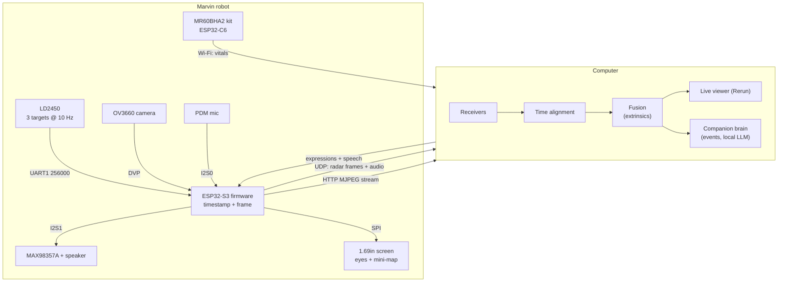

# Architecture

## Principle: dumb device, smart computer

The robot collects, timestamps and forwards data, and it performs: eyes on the screen, sounds on the speaker. The computer does everything else: parsing, fusion, 3D modelling, language and the companion's behaviour. This keeps the firmware small and lets heavy processing run on a GPU.

## Data rates

| Stream | Rate | Bandwidth |
|---|---|---|
| Microphone, 16 kHz 16-bit mono (when streamed) | — | 32 kB/s |
| LD2450 target frames | 10 Hz × 30 bytes | < 1 kB/s |
| Camera, MJPEG VGA | ≈ 10–15 fps | ≈ 300–600 kB/s |
| MR60BHA2 vitals | ≈ 1 Hz | negligible |

Everything fits comfortably in the ESP32-S3's Wi-Fi throughput. (Rev F has no lidar. A D800 on a bench board, as the firmware still supports, adds about 1 800 packets/s × 47 bytes, ≈ 85 kB/s; a D500 ≈ 20 kB/s.)

## Design decisions

| Decision | Why | Alternative considered |
|---|---|---|
| **The MR60BHA2 stays a separate Wi-Fi node** | The kit ships with its own ESP32-C6 and firmware. Routing its data through the S3 would mean opening the case and soldering. Vital signs update at about 1 Hz, so timestamping them on arrival at the PC is precise enough. | UART link through the kit's Grove port (possible later) |
| **Power through the XIAO's USB-C port** | The 5V pin is tied directly to VBUS, so the ESP32 becomes the power distribution point with no extra board. | Separate USB-C breakout with 5.1 kΩ resistors and a soldered distribution board (rev A) |
| **WAGO lever connectors** | Solderless, reliable and reusable. | Soldered perfboard |
| **An upright robot, sensors tilted inside** | To measure heart rate at a desk, the 60 GHz radar must aim at a seated chest, about 20° up. Tilting the whole object (rev E and the early robot sketches) made it look like it was falling backwards. Keeping the shell vertical and tilting the sensors on an internal sled gives the same aim with a calm silhouette. | Tilted face panel (robot v1–v2), lighthouse taper (rev E) |
| **Radars behind a flat, uniform wall** | No holes in front of the radars keeps the design clean. A 1.6 mm PETG wall is half a wavelength at 60 GHz; seen at 20° incidence it is only about 3 % thicker electrically, which costs almost nothing. The anthracite band is a colour change, not a thickness change. | Open radar windows (rev A–D) |
| **No lidar on the robot** (14 October 2026) | The D800 moved to a separate project, a 3D room scanner. Marvin senses people with its two radars and sees with its camera; without the lidar it costs about €115 less, has no motor spinning above the heart-rate radar, and stands about 2 cm lower. The firmware and the host still read a lidar, for the bench and the USB tooling. | The D800 on top of the head (rev D to the first rev F design) |
| **Head and body decoupled by a TPU damper** | The radar measures sub-millimetre chest motion. The damper keeps a knock on the head, a press on the knob or the speaker's buzz out of the body. | Rigid neck |
| **The knob is a button** (14 October 2026) | D7 was the last free pin. A tap is the quickest way to talk without saying "Marvin", a long press (1.5 s) mutes the microphone where you can see it; a tact switch costs nothing and needs no new protocol message (`BUTTON`, action 2 for the long press). The volume stays in the app. | A rotary encoder for the volume (two pins: none left); a decorative knob |
| **Screen vertical, camera tilted** | An IPS screen reads fine from 20° below, but a camera with a ~65° field of view at desk height would frame your chest. Tilting the XIAO by 20° centres your face. | Tilting the whole face |
| **Smoked acrylic face window** | Gives the black-glass look while letting the screen through; printed black PETG would be opaque. | Open screen cut-out with a bezel |
| **Grown-up design language** | The companion is for adults: warm grey, anthracite, one orange knob. Personality comes from the eyes and behaviour, not from decoration. | Cute toy styling (robot v2) |
| **Screen as the face, eyes by default** | A face makes the device readable at a glance: awake, listening, sleepy. The mini-map is still one tap away. | Back screen with a mini-map (rev C–D) |
| **Thread-forming screws into PETG and PLA** | No heat-set inserts and no nuts, except the optional tripod nut. | Brass inserts (rev A) |
| **The voice: one decider, one audio process** | The Java host owns the conversation and every decision around the voice: its settings and their defaults, which audio device it uses (the computer or a robot), when an earcon plays and where, how each answer is cut into clauses and which language each one is. The Python voice sidecar only hears and speaks with the device it is given, and swaps it under the running voice when a robot links or leaves. Nothing is decided twice, so the two can never disagree ([voice.md](voice.md#audio-devices)). | Defaults and the route decided on both sides; a second conversation in Python (retired in October 2026) |
| **One model, two regimes: answers at once, tasks that think** | Two 27B models do not fit beside the voice's models on a 64 GB Mac. The conversation's model answers without reasoning; the same model works on background tasks at a high reasoning level, with Marvin's tools, one task at a time, and gives the model back to the voice the moment someone talks (Ollama runs Qwen3.8 one request at a time). Each tool says what it does to the world and where it may run, so connectors plug in without the conversation knowing them ([intelligence.md](intelligence.md#thinking-and-background-tasks)). | A second, smaller model for the voice; tasks waiting for the owner to be idle |
| **Marvin's own voice, cloned locally** | One voice for French and English, the one chosen for Marvin, synthesised on the computer's GPU (Qwen3-TTS through MLX, streamed) from a short reference recording kept in the repository. | The system voices (say, Piper): a voice per language, kept as fallbacks |

## Coordinate frame

The CAD frame is also the device frame used by the host software:

- origin on the vertical axis of the body, at desk level (Z = 0);
- **X** to the right, **Y** backwards (the face looks towards −Y), **Z** up.

Sensor positions (extrinsics) for rev F. Body values come from `hardware/cad/marvin.scad`. The head's are **frozen** for v1 (14 October 2026, the `FROZEN` block of `marvin.scad`): the head CAD is built to them, and they change only together with that block.

| Sensor | Position (X, Y, Z) mm | Facing |
|---|---|---|
| Camera (lens centre) | (0, −38, 113) | −Y, tilted 20° up. Frozen (`camPos`, `camTilt`). |
| Screen centre (active area) | (0, −38, 92) | −Y, vertical. Frozen (`screenCentre`). |
| MR60BHA2 case, face centre | (0, −28.4, 41.7) | −Y, tilted 20° up. The antenna is off-centre inside the case (about 7 mm to one side). |
| HLK-LD2450, face centre | (0, −33.1, 16.4) | −Y, tilted 10° up |

The head ↔ body interface, frozen with them: head envelope 88 × 80 mm (corner radius 16), from Z = 68 to 124; four M3 neck bolts at (±32, ±20) into pilots in the head floor; the cable hole 30 × 16 mm (corner radius 5) centred at Y = +4.

With the 60 GHz radar at 42 mm and tilted 20°, its boresight crosses the chest band of a seated person (280–450 mm above the desk) between about 0.65 and 1.1 m.

The 24 GHz radar sits below the 60 GHz one, not above it: the 60 GHz beam leaves the robot upwards, and a board standing in front of the upper half of the 60 GHz radar would shadow it.

## Roadmap

- [x] Rev A: enclosure, soldered power distribution
- [x] Rev B: solderless wiring, desk stand, tripod nut
- [x] Rev C: 1.69" colour screen on the back, power bank moved to the pocket, D500 lidar
- [x] Rev D: microphone + speaker, D800 lidar as the reference
- [x] Rev E: Fanou, the desk lighthouse companion
- [x] Rev F design: the upright robot, sensors tilted inside
- [x] Rev F CAD, body half: body, plinth, sensor sled, TPU neck
- [x] Rev F without the lidar (October 2026): two radars, camera, mic, screen, speaker, and the knob on D7
- [ ] Rev F CAD, head: face frame, window, knob (after measuring the screen)
- [ ] First physical build and dimension check
- [x] Protocol v1, simulated robot on a Wemos D1 mini, host receiver and Rerun viewer
- [x] Firmware: UART readers, the face on the screen, MR60BHA2 bridge (untested on hardware)
- [x] Firmware: audio, MJPEG camera, OTA (untested on hardware)
- [x] Firmware: the XIAO bench with a boot self-test ([xiao-bench.md](xiao-bench.md))
- [ ] Firmware: the knob (tap: Talk now, hold: mute), robust Wi-Fi reconnect, the self-test from the robot build
- [x] Host: presence events (brain) and the face, on simulated data
- [x] Host: the Java core, at parity with the Python host and now the default (`./marvin up`; design phases 0 to 2, [design.md](design.md#11-migration-plan))
- [x] Host: memory v1, the new app (design phase 3, [memory.md](memory.md))
- [x] Host: Marvin looks on demand, through the robot's camera or the computer's ([vision.md](vision.md))
- [x] Host: Marvin's own voice (Qwen3-TTS), the voice's device and defaults decided by the Java host, the Python conversation retired
- [x] Host: reasoning levels and background tasks (one model; tasks with budgets, steps kept, cancel, the voice first), see [intelligence.md](intelligence.md#thinking-and-background-tasks)
- [ ] Marvin v1: first-run setup in the app, trustworthy heart rate and breathing, greeting the owner by name, the Soul, approvals, Google Calendar (read) and Gmail drafts (never sent); the Python host's own app retired. Done when the [v1 acceptance checklist](test-plan.md) passes on the real robot
- [ ] Companion: tested daily on the real robot, voice through the robot
- [ ] Host: camera/radar extrinsic calibration
- [ ] Companion: perception and learning, see [intelligence.md](intelligence.md)
- [ ] After v1: connectors over MCP, Wi-Fi set up without `secrets.h`, containers (design phase 6)
- [ ] Optional: MR60BHA2 data over UART
