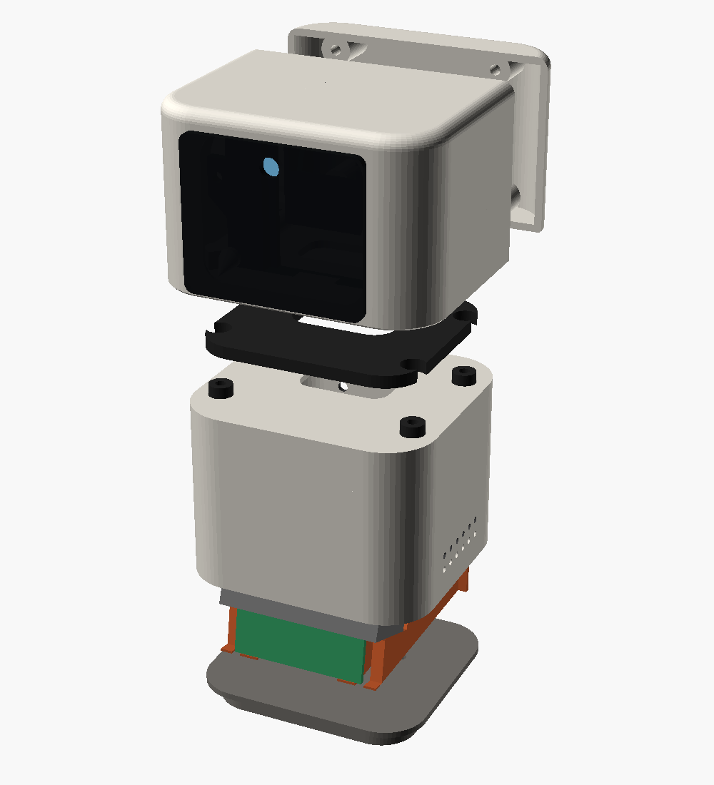

# Printing

All parts come from one parametric OpenSCAD source, [`hardware/cad/marvin.scad`](../hardware/cad/marvin.scad). The STLs in [`hardware/stl/`](../hardware/stl/) are exported already oriented for the print bed, and **none of them needs supports**. Every part fits a 180 × 180 mm bed (Bambu A1 mini and up).

> **Rev F status:** the body half is ready to print (body, plinth, sensor sled, TPU parts). The head (shell, back cap, face frame, knob, switch bracket, window template) is designed and checked, but on **provisional** module sizes: the 1.69" screen, the XIAO ESP32S3 Sense and the tact switch are not measured yet (the `MEASURED (H0)` block of `marvin.scad`). With the published sizes, the XIAO does not fit above the screen at the camera height the head/body interface fixes (C8); `C8_AMEND = true` in `marvin.scad` builds the proposed fix (head and camera 9 mm higher). Print the face frame alone first, as a test fit, before the big head parts. The rev E lighthouse parts are archived in [`hardware/archive/rev-e/`](../hardware/archive/rev-e/).

## Bambu Studio project (A1 + AMS lite)

[`hardware/bambu/marvin_A1.3mf`](../hardware/bambu/marvin_A1.3mf) is ready to open in Bambu Studio: every part on its plate, the filaments and colours set, the per-part settings and the band colour change already in place. Check the filament profiles against your spools, then slice.

| Plate | Parts | Filament | Time (Bambu Studio estimate) |
|---|---|---|---:|
| 1 | Body + sensor sled | PETG warm grey, anthracite band from 14 to 44 mm | 2 h 27 |
| 2 | Plinth, face frame, switch bracket, window template | PETG anthracite | not sliced yet |
| 3 | Neck gasket, 4 grommets, 4 feet | TPU 95A, **external spool** (not the AMS lite) | 59 min |
| 4 | Head shell, back cap, knob | PETG warm grey, the knob in PETG orange | not sliced yet |

Slots: 1 = PETG warm grey, 2 = PETG anthracite, 3 = TPU black, 4 = PETG orange. Textured PEI plate, 0.4 mm nozzle, 0.20 mm layers. The sled also changes colour inside the band: it is hidden in the body, so it does not matter. On plate 4 the AMS swaps to orange on every layer of the knob (its first 14 mm); to save that filament, move the knob to a plate of its own and print it in one colour.

<p align="center"></p>

## Parts

| File | Part | Material | Suggested settings | Notes |
|---|---|---|---|---|
| `1_body.stl` | Body shell | **PETG**, warm grey + anthracite | 0.2 mm, **4 walls of 0.4 mm = exactly 1.6 mm**, 15 % infill | Printed upside down, deck on the bed. The front wall in front of the radars must stay 1.6 mm and flat. The anthracite band is a filament change (see below). |
| `2_plinth.stl` | Plinth | PETG or PLA, anthracite | 0.2 mm, 3 walls, 20 % | Printed upside down, floor plate on the bed. Closes the body from below. The USB-C cable leaves through the notch at the back. |
| `3_sensor_sled.stl` | Sensor sled | PETG | 0.2 mm, 3 walls, 20 % | Printed standing, as installed. Carries the 24 GHz radar at 10° and the 60 GHz radar at 20°; the lever connectors and the amp stick on its back plate. |
| `4_tpu_neck_grommets_feet.stl` | Neck gasket, 4 grommets, 4 feet | **TPU 95A**, black | 0.2 mm, 3 walls, 15 % gyroid, slow (≤ 40 mm/s) | Decouples the head from the body (heart-rate radar). On the A1, feed it from the external spool holder, not the AMS lite. |
| `5_head_shell.stl` | Head shell | PETG, warm grey | 0.2 mm, 4 walls, 15 % | Printed **face down**: the window's 0.8 mm lip and the face come out flat on the textured plate. The head's back is open; the four M3 pilots for the neck are in its floor. |
| `6_head_cap.stl` | Head back cap | PETG, warm grey | 0.2 mm, 4 walls, 15 % | Printed back face down. Four M3 × 10 from behind; the vent slots let the voice reach the microphone. |
| `7_face_frame.stl` | Face frame | PETG, anthracite | 0.2 mm, 3 walls, 25 %, 5 mm brim | Printed upright, as installed. Holds the screen against the window and the XIAO in its 20° pocket. **Print it first, alone, as the test fit (about 40 min).** |
| `8_knob.stl` | Knob | PETG, orange | 0.2 mm, 3 walls, 20 % | Printed outer face down. A press button: it pushes the tact switch. |
| `9_switch_bracket.stl` | Switch bracket | PETG, anthracite | 0.2 mm, 4 walls | Holds the 6 × 6 mm tact switch behind the knob; the switch's legs go through its four holes. |
| `10_window_template.stl` | Window template | any | 0.2 mm, 3 walls, 15 % | Not part of the robot: a guide to cut the acrylic window and drill its camera hole (below). |

The face window is not printed: it is cut from the 2.3 mm smoked acrylic, 56 × 47.7 mm with 3 mm corners and a 6 mm camera hole. [`hardware/dxf/window.dxf`](../hardware/dxf/window.dxf) is its outline in millimetres, centred on the window, for a laser cutter or a print shop.

## Cutting the window by hand

1. Lay the window template on the sheet, **film still on**, with its L-shaped edge hooked over a factory corner of the sheet.
2. Score along the template's two free edges with a sharp knife, 5 to 6 passes, then snap the sheet over a table edge.
3. File the four corners round to the template's radius.
4. Hook the template over the cut piece again and drill the camera hole through its 4 mm guide: a 3 mm pilot first, then 6 mm, slowly, with the acrylic on a piece of wood.
5. Peel the film just before you fit the window.

## Head print notes

- **Front corners of the head shell, back corners of the cap.** The plan corners (16 mm radius) meet the face that lies on the bed tangentially, so the lowest 4.7 mm of each corner are steeper than 45° (the first 2 mm steeper than 60°). They print without supports with Bambu Studio's default overhang cooling and slow-down; if you see the first layers of a corner curl, enable "Slow down for overhang" or print a little cooler. `hardware/scripts/check_head.py` lists them as the only accepted steep overhangs.
- **M3 screws thread-form** into 2.6 mm pilots, as in the body: neck 4 × M3 × 14 + washer (from below, into the head floor), face frame 2 × M3 × 8, switch bracket 2 × M3 × 8, back cap 4 × M3 × 10.
- **Fit check before the big parts:** print the face frame alone, fit the screen (glass against the frame's front face, 1 mm foam pad behind it), the XIAO (it drops into its pocket from above, the USB-C plug then locks it from the right) and the cut acrylic. Note where anything rubs, in mm.

## The anthracite band

The body prints upside down, so the band is a filament change at two heights measured **from the bed**:

| From | To | Colour |
|---:|---:|---|
| 0 mm | 14 mm | Warm grey (top of the body) |
| 14 mm | 44 mm | Anthracite (the band) |
| 44 mm | 58 mm | Warm grey (bottom of the body) |

- **Bambu A1 with AMS lite:** in Bambu Studio, right-click the layer slider at 14 mm and at 44 mm and choose "Change filament".
- **Single-extruder printer:** insert a pause (M600 or "Pause print") at those heights and swap the filament by hand.

## Why PETG in front of the radars

At 60 GHz, a 1.6 mm PETG wall is half a wavelength thick, so it lets the signal through almost unchanged, even when the radar looks through it at 20°. At 24 GHz the same wall is thin enough not to matter. Keep the wall at 1.6 mm and flat, and avoid metallic, glitter or carbon-filled filaments on the body. The filament colour does not matter: the band is only there for looks.

## Regenerating files

```bash
# every print-ready STL, and the window's DXF
hardware/scripts/export_stl.sh

# check the head: fits against the module ghosts, the frozen interface, screws, optics, manifold,
# bed, overhangs, walls (about 3 minutes; --amend checks the C8 amendment, --strict turns the
# provisional-size warnings into failures once H0 is in)
python3 hardware/scripts/check_head.py

# the exploded views in docs/images (headless Linux: prefix with `xvfb-run -a`)
hardware/scripts/render_previews.sh

# the side section diagram in docs/images, cut from the CAD (needs matplotlib)
python3 hardware/scripts/section_diagram.py

# the Bambu Studio project: with the Bambu Studio command line, or without it
BAMBU_STUDIO=/path/to/bambu-studio python3 hardware/scripts/build_3mf.py
python3 hardware/scripts/build_3mf.py --no-studio
python3 hardware/scripts/build_3mf.py --check hardware/bambu/marvin_A1.3mf

# the Blender model hardware/blender/marvin.blend and the robot renders in docs/images
# (needs Blender 4.2+ or the bpy wheel: BLENDER_PY=/path/to/python-with-bpy)
hardware/scripts/build_blend.sh docs/images
```

OpenSCAD 2021.01 or newer is required; the check and the 3MF need Python 3 with numpy. After H0, change only the numbers in the `MEASURED (H0)` block of `marvin.scad`, set `H0_PROVISIONAL = false`, and run the lines above.
