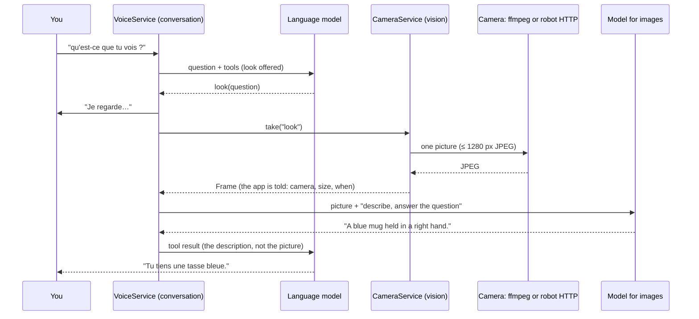

<!-- SPDX-License-Identifier: CC-BY-4.0 -->
# Vision: Marvin looks when you ask

With the Java host, Marvin can look through a camera: ask *"Marvin, qu'est-ce que tu vois ?"*, *"je tiens quoi ?"* or *"lis ce qui est écrit sur mon écran"*, and it takes **one picture**, has it described by the vision model, and answers from that description. The camera is either the robot's (the XIAO's MJPEG camera) or the computer's (a MacBook's built-in camera, a USB webcam on Linux): the same thing for Marvin, chosen by one setting.

It does not watch. Nothing is filmed between two questions, no picture is kept, and nothing leaves the computer.

## Try it on a Mac

1. Install ffmpeg once: `brew install ffmpeg`. (`./marvin doctor` says whether it is there.)
2. `./marvin restart`.
3. The voice must use a model that can see (`qwen3.8:27b-mlx` can), or set **Model for images** in Marvin > Voice & models.
4. In Marvin > Voice & models > **Camera**, press **Test camera**. The first time, macOS asks whether your terminal (Terminal, iTerm, or the IDE that ran `./marvin`) may use the camera: allow it, then press **Test camera** again. The picture shows in the panel, nowhere else.
5. Ask: *"Marvin, qu'est-ce que tu vois ?"* The camera's green light comes on for about a second; Marvin says "Je regarde…", then what it sees. The app shows a short note that Marvin took a picture, and the reply's inspector shows the `look` call and the description.

If you said no to macOS, or the picture never comes: System Settings > Privacy & Security > Camera, switch on the app that runs `./marvin`, then `./marvin restart`.

## Which camera

`camera` in `voice.json`, set in Marvin > Voice & models > Camera:

| Setting | Camera |
|---|---|
| `auto` (default) | The robot's when a robot whose `HELLO` has the camera flag is connected, else the computer's |
| `computer` | The computer's camera only |
| `robot` | The robot's camera only |
| `off` | None: Marvin cannot look |

The panel lists both cameras with what each can do now ("ffmpeg is not installed", "No robot with a camera is connected") and what to do about it. Applying restarts the voice, as the other voice settings do.

## How it works

- **The `look` tool** (`Look`, `LookTool`): one optional argument, `question`, in the person's words. It is offered only while a camera can take a picture, and the persona's camera sentence follows: without a camera Marvin says it cannot look at its camera (as before); with one, it is told to call `look` when asked what it sees, never to describe a sight without calling it for this question, and that each look is a single picture. When a camera comes or goes (a robot connects, the setting changes), the next question gets the new tools and prompt.
- **The picture** is a JPEG of at most 1280 pixels a side, the size the app gives an image shown in Talk. It goes through the same checks as one (`ImageAttachment`: type and size from its bytes, metadata removed) and to the same model: **Model for images**, or the language model when it is empty; a model that cannot see gets the error "… cannot see pictures", which Marvin says.
- **The description** is asked of the vision model in a request of its own (a short system prompt: at most three plain sentences, the question first, text copied exactly when asked to read, no guess about who a person is, their age or health). The conversation's model reads only the description, so the history and the prompt cache never carry the picture.
- **The cameras** (`FrameSource` adapters, `marvin-adapter-camera`):
  - the computer's: an `ffmpeg` process started for one picture (`-f avfoundation -i 0:none` on macOS, `-f v4l2 -i /dev/video0` on Linux, 1280×720 at 30 fps, the first 15 frames dropped while the exposure settles, one MJPEG frame on its standard output). A camera without that mode is asked again in its own mode, and the picture made smaller. The host's own process never opens the camera, as the design asks; a process does, for about a second.
  - the robot's: `GET http://<robot>:81/capture` (one fresh JPEG); a firmware without it gives the first picture of `/stream` (MJPEG). The robot's VGA pictures need no resizing.
- **One picture at a time**, ten seconds at most; a failure says why and what to do ("macOS does not let Marvin use the camera" → the privacy setting; "No camera was found"; "The camera is busy").

The look costs the camera's second, then the vision model reading a 1280×720 picture and writing three sentences. With the same model for words and pictures, Ollama may have to read the conversation's prompt again for the answer that follows (its cache holds one prompt per slot): `OLLAMA_NUM_PARALLEL=2`, or a smaller model for images, avoids that.

## Privacy

- On demand only: the tool runs when the model calls it for a question, or when you press Test camera. There is no continuous mode.
- Each picture is said: the camera's light (computer), a note in the app ("Marvin took a picture with this computer's camera at 14:02"), the reply's inspector (`look`, its question and the description), and the Log panel under Voice ("Marvin looked: one picture with this computer's camera (1280 × 720, not kept)").
- Nothing is kept: the picture lives in memory while it is described, then is dropped. The conversation keeps the description the model wrote (it is what Marvin said it saw), never the picture. The camera test's picture lives in the page that asked for it.
- Nothing leaves the computer: the vision model is the local Ollama; the robot's camera is read over your network.

## API (Java host)

- `GET /api/camera`: `setting`, `settings`, `source` (`computer`, `robot` or `null`), `detail` (which camera, or why none), `fix`, every camera's `sources` (`name`, `available`, `detail`, `fix`), and the `last` picture taken (`source`, `detail`, `width`, `height`, `bytes`, `seconds`, `purpose`, `t`; never the picture).
- `POST /api/camera/snapshot` (`{}`): the camera test. `image` (a `data:image/jpeg;base64,...` URL), `picture`, `camera`. 409 when no camera can be used, 502 when it failed, both with `error`, `fix` and `camera`.
- The event stream sends `camera` (the same fields as `last`) for each picture taken.
- The setting is `camera` in `POST /api/voice/settings`.

## Configuration

| Variable | Default | |
|---|---|---|
| `MARVIN_FFMPEG` | the `PATH`, then `/opt/homebrew/bin`, `/usr/local/bin`, `/usr/bin` | The ffmpeg to run |
| `MARVIN_CAMERA_DEVICE` | `0` on macOS (the built-in camera), `/dev/video0` on Linux | Another camera: list them with `ffmpeg -f avfoundation -list_devices true -i ""` |
| `MARVIN_CAMERA_SIZE` | `1280x720` | The size asked of the computer's camera |
| `MARVIN_CAMERA_INPUT` | | ffmpeg input arguments instead of a camera, to try without one: `-f lavfi -i testsrc2=size=1280x720:rate=30` |

## Not yet

- No continuous perception (faces, pose, gaze as brain inputs, [intelligence.md](intelligence.md)): that is the vision sidecar's job, later. A low-rate perception loop would keep the camera's light on; it waits for something that uses its pictures.
- One camera per look; no zoom or crop on a region.
- The Python host (`marvin-host`) has no `look` tool; it keeps the `camera` setting in `voice.json` and ignores it.
