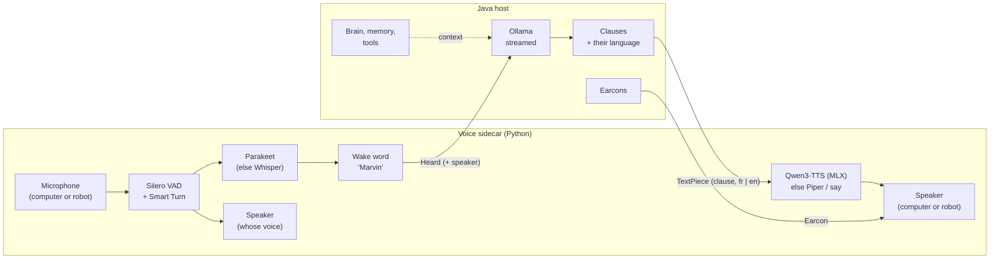
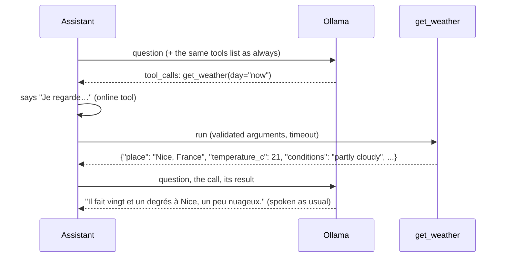

# Voice

Say "Marvin" and ask. Marvin listens with the computer's microphone (or the robot's), hears when
you have finished (Silero VAD and Smart Turn), understands with Parakeet (Whisper as the
fallback), knows whose voice it is when it has learnt it, thinks with a local language model
through Ollama, and answers aloud with its own voice: Qwen3-TTS cloning the voice chosen for it,
in French and in English. **Nothing leaves the
computer**: no cloud API, no account, no telemetry. Models are downloaded once, then everything
works offline. The one exception is opt-out and explicit: online [tools](#tools) such as the
weather send a place name to a free public service; the **Internet** switch turns them off.



**One host.** `./marvin up` starts the Java host ([host-java](../host-java/README.md)), which owns
the conversation (persona, context, model, tools, memory, settings, earcons) and decides where the
voice hears and speaks; the audio loop runs in the **voice sidecar**, a Python process the Java host
starts and watches ([The voice sidecar](#the-voice-sidecar)). The Python side keeps only the audio
and the models: VAD, end of turn, wake word, speech recognition, speaker recognition, the speech
synthesis, the echo filters. (The Python host's
own conversation, `marvin-host talk` and `run --voice`, was retired in October 2026.)

## Install (Mac)

`./marvin up` installs all of this into `host/.venv` the first time (a few minutes;
`./marvin up --no-voice` skips it) and downloads, once and with their progress, Marvin's voice
model (about 1.5 GB), Parakeet (2.5 GB on Apple Silicon) and the ears' small models (Silero VAD,
Smart Turn, the speaker model: 36 MB); only Ollama and its model are yours to install.
`./marvin doctor` says what is there.
By hand:

```bash
cd host
pip install -e ".[sidecar,voice]"   # gRPC, sounddevice (PortAudio included), faster-whisper, webrtcvad,
                                    # onnxruntime (Silero, Smart Turn, the speaker model), and on Apple
                                    # Silicon parakeet-mlx, mlx-whisper and mlx-audio (Qwen3-TTS) on the
                                    # GPU; elsewhere onnx-asr (Parakeet on the CPU)
python -m marvin_host.voice.qwen_tts --prefetch   # Marvin's voice model, once
python -m marvin_host.voice.stt --prefetch        # Parakeet, once (--check: is it here?)
python -m marvin_host.voice.models --prefetch     # Silero VAD, Smart Turn, the speaker model (--check)
brew install ollama                 # or the app from https://ollama.com/download
ollama pull qwen3:4b-instruct       # 2.5 GB, the default model
```

No Homebrew PortAudio is needed: the `sounddevice` wheel ships it. Speech recognition's models live
in `~/.cache/huggingface` (Parakeet: `mlx-community/parakeet-tdt-0.6b-v3` on Apple Silicon,
`istupakov/parakeet-tdt-0.6b-v3-onnx`, int8 only, elsewhere; Whisper, when it is chosen or the
fallback: `mlx-community/whisper-large-v3-turbo` or `small`, downloaded at its first use); the ears'
small models in `~/.local/share/marvin/models/` (`MARVIN_MODELS_DIR`), from pinned revisions,
checked against their SHA-256. After that nothing touches the network. macOS asks once for
microphone access for your terminal.

## Marvin's voice

Marvin speaks with its own voice: **Qwen3-TTS** ([qwen_tts.py](../host/marvin_host/voice/qwen_tts.py))
cloning a short reference recording, "Malicieux", the voice the owner chose
([voices/marvin](../host/marvin_host/voice/voices/marvin/README.md): a French sentence and an English
one, made once with Qwen3-TTS VoiceDesign). One voice says both languages: the core cuts each answer
into clauses and tags each with its language, and every clause is synthesised with its own language
(the pronunciation changes, never the voice). "C'est une bonne idée, let me know when it's done." is
two clauses, French then English; an isolated anglicism ("le build", "une code review") stays in the
French clause ([Two languages in one sentence](#two-languages-in-one-sentence)). The name needs no
respelling: the reference says "Marvin" right.

- **On a Mac with Apple Silicon** it runs on the GPU through MLX
  ([mlx-audio](https://github.com/Blaizzy/mlx-audio)), model
  `mlx-community/Qwen3-TTS-12Hz-0.6B-Base-bf16` (the smallest that clones well; `1.7B` with
  `MARVIN_QWEN_TTS_SIZE=1.7b`), and **streams**: the first sound of a clause plays while the rest is
  still being made. The reference's speech codes are computed once and kept in memory; the model
  stays loaded while the sidecar runs, and is warmed up (one French and one English word) when the
  voice starts, so the first answer is not slower than the others.
- **Elsewhere**, the official `qwen-tts` package (`pip install -e ".[qwen]"`, PyTorch) runs the same
  model, on a GPU (CUDA) or, very slowly, on the CPU (tens of seconds a sentence: `auto` never picks
  it there). Its encoded reference is cached in `~/.local/share/marvin/voices/`.
- **Fallbacks**: if Qwen3-TTS is not installed, cannot load or fails, Marvin speaks with Piper (when
  installed) or macOS `say`, with a voice per language; the reply then keeps one voice (the language
  of its first clause), and "Marvin" is respelled "Marvine" for a French voice.

In **Marvin > Voice & models**, **Speech** chooses the engine (**Auto**, **Marvin's voice
(Qwen3-TTS)**, macOS say, Piper, espeak-ng) and the voice (`marvin` for Qwen3-TTS; for the others,
the installed Piper and macOS voices). In `voice.json`: `"tts": "auto" | "qwen" | "say" | "piper" |
"espeak"`, `"tts_voice": "marvin"`. `python -m marvin_host.voice.qwen_tts --say "Bonjour, je suis
Marvin." --out marvin.wav` tries it alone; `--check` says which backend and model, and whether the
weights are there.

Piper voices stay optional (`pip install piper-tts`; `fr_FR-siwis-medium` and `en_GB-alan-medium`
are downloaded on first use into `~/.local/share/marvin/piper`, 60 MB each). The macOS `say` voices
improve a lot with the "Enhanced" versions of Thomas (French) and Daniel (English), in System
Settings > Accessibility > Spoken Content > System Voice > Manage Voices.

## The ears

What Marvin hears, and how it decides you have finished, are four small pieces, each with a fallback
that needs no model ([`vad.py`](../host/marvin_host/voice/vad.py),
[`turn.py`](../host/marvin_host/voice/turn.py), [`stt.py`](../host/marvin_host/voice/stt.py),
[`lexicon.py`](../host/marvin_host/voice/lexicon.py), [`speaker.py`](../host/marvin_host/voice/speaker.py),
[`models.py`](../host/marvin_host/voice/models.py)):

| Piece | Default | Licence | Without it |
|---|---|---|---|
| Voice activity | **Silero VAD v6.2** (2.3 MB ONNX, onnxruntime on the CPU, 32 ms chunks, under a millisecond each) | MIT | WebRTC VAD, then an energy threshold |
| End of a question | **Smart Turn v3.2** (pipecat-ai, Whisper-Tiny encoder and a linear head, 8 MB int8 ONNX, 23 languages; 70 ms on a 2-core cloud CPU, a few tens of ms on a laptop) | BSD-2-Clause | silence timers and the word rules below |
| Speech recognition | **Parakeet TDT 0.6B v3** (NVIDIA; parakeet-mlx on Apple Silicon, onnx-asr int8 elsewhere) | CC-BY-4.0 (model), Apache-2.0 (parakeet-mlx), MIT (onnx-asr) | Whisper large-v3-turbo (MLX) or `small` (CPU) |
| Whose voice | **WeSpeaker ECAPA-TDNN 512**, trained on VoxCeleb2 (25 MB ONNX, 20-60 ms a question, beside speech recognition) | Apache-2.0 | no speaker recognition |

`"vad": "auto" | "silero" | "webrtc" | "energy"` and `"turn": "auto" | "smart-turn" | "silence"` in
`voice.json` choose; `auto` takes the model when its file is here. The status line of the voice
sidecar's log says what runs: `voice ready (parakeet (mlx) ..., qwen ...; silero VAD, smart-turn end
of turn, 1 voiceprint(s); computer)`.

### What Marvin hears

The app's **Senses** screen ([ui.md](ui.md#what-it-shows)) shows the ears at work. Beside the microphone's level
(`Level`, now with `dbfs`: the loudest 20 ms frame since the last one, -100 when muted), the sidecar sends a `Hearing`
message for each end-of-turn decision while someone pauses (`kind: "turn"`: complete or not, its probability, how long
Smart Turn took) and for each utterance once it is judged (`kind: "utterance"`: its length and loudness, the speech
recognition that read it and the time left to wait for it, whether it started during the pause, the transcript before
any cleaning, its language and probability, whether "Marvin" was in it, whose voice, and its outcome: `heard`, a
question for the core; `listening`, the name alone; `ignored`, with the reason the conversation shows; `dropped`, not
judged: too quiet, Marvin busy and no name, no name outside a listening window). No audio is sent. The Java host keeps
the last 20 in memory for the app, never on disk, and sends them only on the Senses screen's own stream
(`/api/senses/stream`), not the app's main one. The message is an addition to contract version 2: an older core
ignores it, and a core reading an older sidecar shows no diagnostics and no dBFS.

### When you have finished

A fixed silence is a poor judge: too short and "Je voudrais... [thinks] un café" is cut in two, too
long and every answer waits. With Smart Turn:

1. Silero hears **0.2 s** of silence (`turn_check_ms`): Smart Turn reads the last 8 s of what you
   said (words and intonation) and says whether the turn is complete.
2. **Complete** (probability at least 0.5, the model's own threshold): the question ends now. The
   end of speech costs 0.2 s plus the decision, instead of 0.55 s.
3. **Not finished**: Marvin keeps listening; the question ends after **2 s** of silence
   (`turn_max_ms`) unless you go on, and then the next pause is judged again on the longer
   utterance.

The decision's time is in each question's latency (`turn`, `turn_p`: its probability) and in the
log line `first word ... (end of speech 0.21, end of turn 0.018, ...)`; a decision over its 50 ms
budget is logged. **One thought, one question** (below) stays: when Smart Turn says "finished" too
early and you go on before Marvin's first word, both parts are still joined (a test shows it). The
word rules ("..., et", "parce que", a lone "OK") are only the fallback without Smart Turn: the model
hears the same thing in the voice itself, without waiting for a transcript.

### Speech recognition

**Parakeet TDT 0.6B v3** is the default (`"stt": "auto"`, or `"parakeet"`): the best French word
error rate of the open models of its size, punctuation and capitals included, and as a transducer it
does not invent the subtitles Whisper hears in silence. It writes 25 European languages but does not
say which one it heard: the turn's language is read from its words (`text.detect_language`: French
and English function words, elisions and accents, contractions). A clear sentence switches the
conversation's language; "Marvin ?" or "OK" keep it; a sentence in both is the language with the
most words, with a lower confidence (the follow-up rule then asks for the name to switch). Forcing a
language (`"language": "fr"`) still works. A transcript whose tokens' mean confidence is under 0.15
is rejected as "low confidence" (MLX gives one; to tune on real use).

- **Apple Silicon**: `parakeet-mlx`, `mlx-community/parakeet-tdt-0.6b-v3` (2.5 GB, loaded in bf16 on
  the GPU, warmed up at start).
- **Elsewhere**: `onnx-asr`, the int8 ONNX export (670 MB): measured here, 0.6 s for a 4 s question
  on two cloud CPU cores, punctuation and capitals right in both languages ("Coucou, c'est moi,
  Marvin, ton petit robot de bureau.").
- **Whisper** stays selectable (`"stt": "mlx"` or `"faster-whisper"`, Marvin > Voice & models) and is
  the fallback when Parakeet is missing or fails to load.

### Names and words

`"vocabulary": ["Marvin", "Aashma", "Laurine", "Bosco"]` (Marvin > Voice & models, **Names and
words**): the people, places and projects speech recognition should spell right. Whisper is told
them beforehand (hot words, or its initial prompt on MLX). Parakeet's MLX port has no context
biasing (NVIDIA's NeMo has word boosting; it is not ported), so every engine's transcript is
**corrected** after it: a word, or two words run apart ("Ash ma"), that sounds like a term is
written as the term. "Sounds like" is a small French and English phonetic key (doubled letters,
ph/f, c/k/qu, y/i, silent h and final e, "-ine"/"-in") and an edit distance: equal keys always
count; a near key only for a capitalised word or a very close long one; common words never
("marin", "martin", "matin" are not "Marvin"). "Marvine" becomes "Marvin", "Ashma" "Aashma",
"Lorine" "Laurine", "Bosko" "Bosco". The correction runs before the wake word is looked for.

### The wake word: no keyword model, on purpose

The name is still found in the transcript ([`wake.py`](../host/marvin_host/voice/wake.py): fuzzy
"Marvin" at the start or the end, French and English spellings: "Marvine", "Marveen", "Marvigne",
"Mar vin"...). A dedicated keyword spotter was weighed and set aside:

- **openWakeWord**'s code is Apache-2.0, but its pre-trained models are CC BY-NC-SA: they cannot
  ship here. A "Marvin" model of our own needs tens of thousands of synthetic clips, negative audio
  whose licences are mixed, and hours of training, per voice and accent; what it would decide is
  what the transcript already says.
- With Silero, an utterance exists only when there is speech (no keyboard, no fan), and Parakeet on
  a 1-3 s utterance costs tens of milliseconds on the Mac's GPU; the transcript also gives the
  question ("Marvin, quelle heure est-il ?") in the same pass.
- The fuzzy matcher handles the French "Marvine" and English "Marvin" alike, and the vocabulary
  correction catches the rest.

`WakeWordDetector` stays the interface for a keyword model (`check(pcm) -> WakeMatch(query=None)`:
the engine then transcribes the utterance itself), should a license-clean one appear.

## Your voice

At the first start with the voice on, the app offers once to learn your voice (also in Marvin >
Voice & models, **Your voice**, **Calibrate a voice**; [ui.md](ui.md)). It takes about thirty
seconds, through the device the voice is using (the computer's microphone, or the robot's):

1. **The room**: you stay quiet for 1.5 s; Marvin measures the noise floor (and, with Silero, how
   much the room's noise looks like speech to it).
2. **Three sentences**, shown one at a time, in French and English: "Bonjour Marvin, je m'appelle
   Sébastien.", "Hey Marvin, what's the weather like today?", "Marvin, rappelle-moi d'arroser les
   plantes demain matin." Each is recognised and shown back ("I heard: ...", how close it is to the
   text, its level): you see speech recognition work before relying on it. Too short or not
   understood: read it again (three tries).
3. **The device's thresholds** ([`enroll.py`](../host/marvin_host/voice/enroll.py), `calibrate`),
   from the noise floor (90th percentile of the quiet part's 20 ms frames) and your voice's level
   (median of its loud frames): the VAD's floor `vad_min_dbfs` = 6 dB above the noise but at least
   25 dB under your voice; "too quiet" `speech_min_dbfs` = 18 dB under your voice (someone across
   the room still counts) but at least 8 dB above the noise; Silero's `vad_threshold` = 0.5, or 0.1
   above what the room's noise reached (a TV, music), up to 0.85. They are written to that device's
   profile in `voice.json` (`devices.computer` or `devices.robot`, with a `calibration` record: when,
   who, the levels, the warnings), and the voice restarts with them. Warnings: a voice that clips, a
   voice very quiet, a room noisy for that microphone (under 15 dB of margin), a room whose noise
   sounds like speech, a sentence misheard.
4. **Your voiceprint** (with the speaker model): the mean of the three sentences' speaker
   embeddings, under your name.

At run time each question's speaker is recognised while its words are (cosine similarity with every
voiceprint; from 0.45 it is that person; questions under 1 s are not judged). The core gets
`speaker: Sébastien (0.82)` or `unknown` with the question (`Heard.speaker`), the conversation entry
keeps it, and Marvin's context says it: "The voice asking is Sébastien's (you recognise it): what
they tell you about themselves is about Sébastien." or that it does not recognise the voice, so
memory attributes what it learns to the right person. **Only answer voices Marvin knows**
(`known_voices_only`, off by default) ignores the others (`ignored: unknown voice (0.12, closest
Sébastien)`); a short reply too brief to judge counts as the voice recognised in the last minute.
Several people can be enrolled (up to 8; calibrating a known name again replaces their print).

**Privacy**: voiceprints are kept in `voiceprints.json` next to `voice.json`, readable by you only,
and go nowhere but to the voice sidecar on this computer; the app never shows the vectors.
**Delete** in Your voice removes one at once (the voice restarts without it). The demo keeps its
own, empty, file. API: `GET /api/voice/enroll` (the state, the sentences, what was heard, the
people, each device's calibration, `first_run`), `POST /api/voice/enroll` `{"name"}` (409 while the
voice is off), `POST /api/voice/enroll/cancel`, `POST /api/voice/people/forget` `{"name"}`.

## Use

How to talk to it:

- **"Marvin, what's the capital of Peru?"** in one breath: the name is removed, the rest is the question.
- **"Marvin."** alone: a soft two-note earcon, then ask within 6 seconds.
- **Talk now** (the app's button, or the bench board's Talk button): the same, without the name. It
  stops whatever Marvin is saying or thinking, and the microphone is open at once: what you say right
  after pressing is never clipped (see [Talk now and barge-in](#talk-now-and-barge-in)).
- **Follow-up**: for 5 seconds after an answer, ask again without the name.
- **Interrupt**: say "Marvin" while it thinks, or press Talk now. While it speaks, saying the name
  only works on a duplex device (see below).
- **Take your time**: a pause in the middle of a sentence does not cut you off: Smart Turn hears
  that you have not finished and Marvin waits up to 2 s. If you go on right after a question,
  before Marvin's first word, it waits and takes both as one question. See
  [When you have finished](#when-you-have-finished) and
  [One thought, one question](#one-thought-one-question).
- It answers in the language you speak (French and English are expected; French by default), and
  mixes them as you do.
- It forgets the conversation after 3 minutes of silence.

The model also knows what the brain and memory know, stated as plain facts: whether someone is
there, how long they have been seated, breathing and heart rate while those readings are reliable,
recent events, the room, what it remembers of the owner. Marvin also speaks first once in a while:
a break reminder (on by default) and, if you want it, a "welcome back" after 30 minutes away. At
most one such sentence every 10 minutes, never during a conversation.

### From the app

The app's **Talk** panel is the voice's control center ([ui.md](ui.md)): turn the voice on and off
without restarting anything, see what Marvin heard and said (and what it chose not to answer, and
why), how long each answer took, type a question, open a listening window without the name
(**Talk now**), mute the microphone, stop Marvin mid-sentence. If something is missing (the `voice`
extra, a microphone, Ollama, the model), the panel says what and how to fix it. Turning the voice on
is remembered: it starts with the host next time.

**Marvin > Voice & models** changes the model (from the list Ollama has), speech recognition, the
names and words it must get right, whether only known voices are answered, the speech engine and
voice, the language, the wake word, the follow-up window, spoken break reminders, tools and the
Internet switch, the home location for the weather, the model for images and the camera; **Your
voice** calibrates the microphone and learns voices. They are saved to `voice.json` below, and the voice restarts with them.

### Your defaults

`~/.config/marvin/voice.json` (or `$MARVIN_CONFIG_DIR/voice.json`, next to `calibration.json`)
holds your settings. The Java host is the only place where their defaults are written
([`VoiceSettings`](../host-java/marvin-domain/src/main/java/marvin/host/domain/conversation/VoiceSettings.java)):
it sends every value to the voice sidecar, which has none of its own (its tests check that their
copies stay equal: `marvin-contracts/golden/voice/configure_defaults.json`). Example:

```json
{
  "llm_model": "qwen3.8:27b-mlx",
  "stt": "mlx",
  "stt_model": "turbo",
  "tts": "qwen",
  "tts_voice": "marvin",
  "language": null,
  "audio_route": "auto",
  "end_silence_ms": 550,
  "vocabulary": ["Marvin", "Aashma", "Laurine", "Bosco"],
  "known_voices_only": false,
  "devices": {
    "computer": {"duplex": false, "echo_tail_s": 0.8, "input_device": null, "output_device": null,
                 "vad_min_dbfs": -62.2, "speech_min_dbfs": -45.5, "vad_threshold": 0.5,
                 "calibration": {"at": "2026-10-04T11:02:00", "name": "Sébastien", "noise_dbfs": -68.2,
                                 "speech_dbfs": -27.5, "warnings": []}},
    "robot": {"echo_tail_s": 0.5, "speech_min_dbfs": -45}
  }
}
```

Other keys: `ollama_host`, `default_language`, `wake`, `follow_up_s`, `listen_window_s`,
`speculative_stt`, `speculate_after_s` (0.25), `continue_grace_s` (1.5, 0 turns merging off),
`continue_join_s` (6, 0: a question that cuts an answer never joins the one it cut),
`end_silence_long_ms` (1100, 0 turns the longer pause off), `chime` (the earcons, default true),
`tools` (default true), `internet` (online tools, default true), `home_place` (the weather's place
when none is said, e.g. `"Nice"`), `reminders` (spoken break reminders, default true),
`welcome_back` (default false), `vision_model`, `camera`, `vad` and `turn` (`auto`), `turn_check_ms`
(200) and `turn_max_ms` (2000), `speaker_threshold` (0.45). `devices` changes the two
[audio devices'](#audio-devices) profiles; the older top-level `duplex`, `echo_tail_s`,
`input_device` and `output_device` still set the computer's.

## Tools

The model can call tools for live information the context block does not give. There is one
today: **`get_weather`**, the weather now, today or tomorrow, anywhere. "Marvin, quel temps
fait-il ?", "Will it rain tomorrow in Lyon?".



How it works (host-java: [`AnswerLoop`](../host-java/marvin-application/src/main/java/marvin/host/application/conversation/AnswerLoop.java),
[`ToolRegistry`](../host-java/marvin-application/src/main/java/marvin/host/application/conversation/tools/ToolRegistry.java)):

- Every request carries the same `tools` list (OpenAI-style function schemas, keys sorted, tools
  sorted by name: the same bytes every time). Ollama renders it into the prompt next to the system
  message, so like the system prompt it is part of what Ollama caches; the warm-up sends it too.
  The list changes only when a setting changes (tools, Internet), which costs one uncached question.
- When the model calls tools (Ollama streams `message.tool_calls`, usually in one chunk with empty
  content), nothing more of that response is spoken. The core runs the calls, adds the assistant
  message with its `tool_calls` and one `tool` message per call, and asks again. What the model says
  then is spoken as usual. At most 3 rounds; after that further calls are ignored and, if the model
  said nothing, Marvin says it found no answer.
- **No dead air**: while an online tool runs, Marvin says a short filler ("Je regarde…" / "Let me
  check…"). Only for online tools (a network round trip is 0.3 to 1 s); offline tools answer in
  milliseconds and get none. The filler is spoken, shown in the conversation, but not kept in the
  model's history, and not counted as the answer's first word.
- **Robustness**: a call to an unknown tool, bad arguments (checked against the schema's required
  keys, types and enums), an exception or a timeout all become an error result the model can talk
  about ("the weather service did not answer in time"). Some small models write the call as text
  (a JSON object, `<tool_call>` tags, a code block) instead of a real call: a reply that starts like
  that is held back, read as a tool call when it is one, and JSON is never spoken.
- **Reasoning written into the answer**: after a tool result, Qwen 3.5 models (seen with
  `qwen3.8:27b` on Ollama 0.34) sometimes think in the answer itself even with thinking off, then
  write `</think>` and answer again. The answer to a tool result is held until it is complete and
  everything before a lone `</think>` is dropped; the filler covers the wait. `<think>` tags are
  never spoken.
- **Home**: with tools on and a home location set, the context tells the model where the owner
  lives, so "what's the weather?" calls the tool instead of asking for a city.
- **History**: the whole exchange (question, calls, results, answer) is kept, so the next question's
  prefix is unchanged; when the history is trimmed, whole turns go, a tool exchange is never split.
- **Models without tools** (Ollama answers "does not support tools"): Marvin asks again without tools
  and stops offering them to that model; the persona then says it has no internet.
- **The inspector** (the app's "why did Marvin say that") lists each call with its arguments,
  result or error and duration, and the timing bar gets **Tools** and **Model (again)**.

Memory's tools (`remember`, `recall`, `forget`: [memory.md](memory.md)) and `look`
([vision.md](vision.md)) follow the same loop.

### The weather

`get_weather(place?, day?)`: `place` is a city or town (default: `home_place`), `day` is `now`
(default: current conditions and today's range), `today` or `tomorrow`. It uses
[Open-Meteo](https://open-meteo.com) (free, no account, no API key): the geocoding API for the
place, then the forecast API. The result has the units in its keys (`temperature_c`, `wind_kmh`,
`rain_chance_percent`) and the weather code in plain English ("light rain"). Places are looked up
once per session and forecasts reused for 10 minutes (one forecast serves now, today and
tomorrow), so "and tomorrow?" costs nothing. Both requests share a 4 s budget. Without a place and
without `home_place`, the tool asks the model to ask the person which city.

**Privacy**: only the place name (to the geocoding API) and its coordinates (to the forecast API)
are sent, nothing about the person, the room or the conversation. **Internet off**
(`"internet": false`, or the switch in Settings > Voice) removes online tools from the list: Marvin
is fully offline again and says it has no internet.

**Latency**: a question that needs the weather costs about one extra model turn plus the requests:
the first token of the call (as usual), 0.3-1 s for Open-Meteo (the filler covers it), then the
second request's first token (the prompt is cached, so it is short). Questions that need no tool
cost nothing more than the tool definitions in the cached prompt.

### Adding a tool

A tool is a function and a description: a `ToolRegistry.Tool` (its spec: name, description, JSON
schema, online or not, timeout; and a `ToolFunction` returning a `ToolResult`) added where
`VoiceService.registry` builds the list. Keep descriptions short and stable (they are in every
prompt), results small (the model reads them), and put units in the key names. `WeatherTool` is the
example to follow, and `ToolVectorsTest`, `LookToolTest` and `AnswerLoopTest` show how to test one.

## It never answers itself

Without echo cancellation, the microphone hears the speaker. Two layers keep Marvin's own voice
out of the conversation ([`echo.py`](../host/marvin_host/voice/echo.py)):

1. **Half duplex** (every device today): from its first word until the device's echo tail (0.8 s on
   the computer, 0.5 s on the robot) after the speaker has played the last one (plus the output
   latency), the microphone is deaf, and an utterance that started meanwhile is dropped. The gate is
   applied when the sound is captured, not when it is analysed, so it holds even when speech
   recognition is running late. The cost: saying "Marvin" cannot interrupt it while it speaks (Talk
   now can).
2. **Transcript filter** (always): anything heard that repeats one of its last two replies
   (the whole reply, a garbled copy, or a contiguous chunk of it) is ignored and logged as
   `(ignored: own voice)`.

A duplex device (`"devices": {"computer": {"duplex": true}}`, for a headset; later the robot with echo
cancellation) removes the first layer; the second one stays. Then "Marvin" interrupts it while it
speaks, except while its own reply contains its name.

The earcons are not speech either: while one plays, the microphone's frames are kept (they can be the
start of what you say) but never count as voice.

## Audio devices

The voice hears and speaks through one **audio device** at a time
([`device.py`](../host/marvin_host/voice/device.py)): the computer's microphone and speaker, or a
robot's (relayed by the Java host). **The Java host decides which**, once (`audio_route`: `computer`,
`robot`, or `auto`: the robot's when one with a microphone and a speaker is connected, else the
computer's), and sends it with its profile
([`AudioDeviceProfile`](../host-java/marvin-domain/src/main/java/marvin/host/domain/conversation/AudioDeviceProfile.java)):

| | Computer | Robot | Why |
|---|---|---|---|
| Duplex | no | no | Neither cancels its echo |
| Echo tail | 0.8 s + the speaker's latency | 0.5 s + 0.05 s | The robot's player says when it has really finished; the Mac's buffer adds its own latency |
| VAD floor (`vad_min_dbfs`) | -60 dBFS | -55 dBFS | The robot's microphone has 12 dB of gain ([audio.md](audio.md)) and the lidar's motor turns a few centimetres away |
| "Too quiet" (`speech_min_dbfs`) | -50 dBFS | -45 dBFS | Same |
| VAD aggressiveness | 2 | 3 | Same (WebRTC only) |
| Silero threshold (`vad_threshold`) | 0.5 | 0.5 | Raised by the calibration when the room's noise sounds like speech |
| Earcons | the sidecar's tones on the speaker | the robot's built-in sounds (`SOUND`) | |

The robot's values are starting points, to tune on the hardware (`devices.robot` in `voice.json`).
The [voice calibration](#your-voice) measures them on the device itself (the floor, "too quiet",
Silero's threshold) and writes them there.
When a robot links or leaves, the Java host sends the new device and the running voice **swaps** it
(`VoiceEngine.swap_device`): what was being said on the old speaker stops, the new microphone starts,
and the models, the listening windows and the conversation stay; no restart. The sidecar never
chooses a robot itself.

## Talk now and barge-in

Talk now (and a barge-in, and Stop) **cut** what Marvin is doing, and the voice keeps one lock
around its state, so a cut is clean whatever it lands on:

- **While it speaks**: the speaker is stopped at once, and nothing of the cut answer can play after
  the cut (a sentence that finished synthesising just then is dropped, never played) nor set the
  status back to "speaking". The microphone, deaf while Marvin spoke, reopens as soon as the speaker
  is really silent (the device's buffer played out: a few tens of milliseconds), without waiting for
  the cut answer's synthesis to end; meanwhile what it hears is kept as the pre-roll of what you say,
  so the start of your question is never clipped. A question within 6 s of the one it cut goes on
  from it ([One thought, one question](#one-thought-one-question)).
- **While it thinks**: the question is cut before any word; it leaves no empty "interrupted" answer
  in the conversation. What you say next continues it: one question, one bubble, which replaces the
  first one.
- **With a streaming voice** (Qwen3-TTS on MLX) the synthesis itself stops at the cut.

## Models

| Part | Default | Why | Alternatives |
|---|---|---|---|
| Speech to text, Apple Silicon | Parakeet TDT 0.6B v3 on the GPU (parakeet-mlx, `mlx-community/parakeet-tdt-0.6b-v3`) | The best French of the open models of its size, punctuation and capitals, no inventions on silence | `"stt": "mlx"`: `mlx-community/whisper-large-v3-turbo` (or `small`, `medium`, any MLX Whisper repo) |
| Speech to text, elsewhere | Parakeet TDT 0.6B v3, int8, CPU (onnx-asr) | 0.6 s for a 4 s question on two cores, better than Whisper `small` at 4-5 s | `"stt": "faster-whisper"`: Whisper `small` (`tiny`, `base`, `turbo`, `large-v3`) |
| Language model | `qwen3:4b-instruct` (the owner runs `qwen3.8:27b-mlx`) | Qwen3 4B Instruct 2507: good French and English, non-thinking. Every request sends `think: false`, voice turns included, so thinking models answer at once too | see the table below |
| Speech | Qwen3-TTS 0.6B Base cloning Marvin's voice, on the GPU through MLX (streamed) | One voice for both languages, close to real time on Apple Silicon, entirely local | the 1.7B model (`MARVIN_QWEN_TTS_SIZE=1.7b`); Piper `fr_FR-siwis-medium`, `en_GB-alan-medium`; macOS `say` (Thomas, Daniel); `espeak-ng` as a last resort |
| Voice activity | Silero VAD v6.2 (ONNX) | Tells speech from keyboard, fans and music; under a millisecond per 32 ms | WebRTC VAD, then an energy threshold |
| End of a question | Smart Turn v3.2 (ONNX, int8) | Hears an unfinished sentence in the voice itself: short pauses end finished questions sooner, unfinished ones wait | silence timers and word rules |
| Whose voice | WeSpeaker ECAPA-TDNN 512 (ONNX) | Small, Apache-2.0, good on short clips; runs beside speech recognition | none |

Choosing the language model (rough expectations on Apple Silicon with Ollama, model loaded and
system prompt cached; M1/M2 at the slow end, M3/M4 Pro/Max at the fast end):

| Size | Examples | Memory | First token | Speed | Quality |
|---|---|---|---|---|---|
| 1.7-4B | `qwen3:4b-instruct` (default), `qwen3:1.7b`, `gemma3:4b` | 2-4 GB | 0.1-0.3 s | 30-80 tokens/s | Good small talk and simple facts; confuses details |
| 7-9B | `qwen3:8b`, `llama3.1:8b` | 5-6 GB | 0.2-0.6 s | 20-45 tokens/s | Noticeably better reasoning and French; still fast enough to feel live |
| 24-32B | `gemma3:27b`, `qwen3:32b`, `mistral-small3.2` | 16-20 GB (32 GB Mac) | 0.6-2 s | 8-20 tokens/s | Clearly smarter; the pause before the first word becomes noticeable |

The first question after starting a model costs its loading time (5-20 s for 27B) and the
processing of the system prompt (several seconds for 27B). Marvin does both at start-up by
rehearsing a real question (same system prompt, same options: `num_ctx` 16384, `think` off,
`keep_alive` 30 min, streamed), then checks that the next one reuses the cached prompt:
`model ... ready (prompt cached) in X s; first token now Y s`. If Y stays high, the log says the
server did not reuse the cache. Options that differ between requests (for instance another app
using the same model with another `num_ctx`) make Ollama reload the model.

## One thought, one question

People pause in the middle of a thought ("Je veux aussi que tu saches que je suis développeur.
[pause] Et j'aime la voile."). Three rules keep Marvin from cutting in, without delaying every
answer ([`engine.py`](../host/marvin_host/voice/engine.py)):

1. **A question that goes on is one question.** When speech starts again less than
   `continue_grace_s` (1.5 s) after a question ended, and Marvin has not made a sound yet, the
   answer waits (the model keeps writing, nothing is played). If the new utterance is real speech,
   the pending answer is cancelled (the core's model request too: `Interrupted` "merged") and both
   texts go as one question; a cough or a "Merci." is ignored and the waiting answer plays at once.
   The log says `joined 2 utterances`, the app shows one bubble, and the reply inspector says the
   question was joined. 1.5 s because pauses inside a turn are mostly under a second, while the
   first word comes 1.5-2.5 s after the end of speech: past 1.5 s Marvin is usually already
   speaking, and the rule below takes over.
2. **Cut to go on.** When a question cuts Marvin's answer (saying "Marvin, ..." in duplex mode,
   or Talk now then speaking) less than `continue_join_s` (6 s) after the question it cuts ended,
   they are joined too, so the model gets the whole thought. What Marvin said stays in the
   conversation, marked interrupted; the cut turn leaves the model's history (the joined question
   says it all again).
3. **The pause that ends a question adapts.** With Smart Turn, see
   [When you have finished](#when-you-have-finished). Without it (the fallback): the speculative
   transcript (started after 0.25 s of silence) is read when the pause reaches `end_silence_ms`
   (0.55 s): if it ends with a comma or an
   ellipsis, a conjunction or connective ("et", "mais", "que", "parce que", "donc", "alors", "and",
   "but", "so", "because"...), a filler ("euh", "um") or is only a lead-in ("OK", "bon", "alors",
   "OK so"), the question ends after `end_silence_long_ms` (1.1 s) instead
   (`filters.announces_more`). A question or an exclamation never waits. The transcript was going to
   be waited for anyway, so a finished question costs nothing more. A lone "OK" in a follow-up
   window is also kept and put in front of what follows within 1.5 s.

**The listening window waits for you.** From the moment you start talking in a listening window
(follow-up, Talk now, "Marvin." alone) until what you said is judged, the window does not run out
(`listen_remaining()` is `None`, `Status.hearing` is set, the app shows "Listening…" instead of the
draining bar); if nothing was asked, it goes on with at least the time it had left (and 1.5 s).

## Showing Marvin an image

With the Java host, the owner can show Marvin a photo in Talk and ask about it: the photo is seen only
with the question it came with. (Marvin can also look through a camera when asked, with the `look`
tool: [vision.md](vision.md).)

- **In the app**: the image button beside the text box (on a phone: **Take a photo** or **Choose a
  photo**), or drop a picture on the conversation, or paste one into the text box. The page makes it
  small first (longest side 1280 px, JPEG at 0.85; redrawing it also leaves out where and when it was
  taken), sends it, and shows it above the text box: "Goes with your next question, typed or spoken",
  with its size and the model that will look at it, and a button to remove it. The next question,
  typed or spoken ("Marvin, what is this?"), takes it; the question's bubble shows the thumbnail and
  the reply inspector says what was sent (pixels, bytes) and which model saw it.
- **The host** checks the image from its bytes (JPEG or PNG, at most 2 MB and 4096 pixels a side,
  whatever the client says it is), removes its metadata (a JPEG's EXIF, XMP and comments; a PNG's
  text and EXIF chunks), keeps it in memory until the next question takes it (or ten minutes pass),
  and sends it as base64 in Ollama's `images`, on that question's message only. The history the next
  questions carry keeps the question's words with a note, "[The person showed you an image here. It
  is no longer attached: only your answer below says what was in it.]", and Marvin's answer, which
  says what it saw: the image is never sent again, so the prompt cache and the first word stay as
  fast as before.
- **Which model**: `vision_model` in Marvin > Voice (**Model for images**); empty means the language
  model. The host asks Ollama once per model (`/api/show`, `capabilities` containing `vision`); a
  model that cannot see images is refused as soon as the image is attached: "This model cannot see
  images; choose a vision model in Marvin > Voice". With another model for images, questions with an
  image go to it (the first one loads it) and the others stay with the language model.
- **The prompt**: the system prompt has one rule for it, the same for every question (so it stays
  cached): when the message says an image is attached, describe it and answer from it honestly, and
  it is not the camera. The question's own message says "The person shows you an image: it is attached
  to this message." just before what the person said.
- **Kept**: nothing of the image. The conversation entry records its type, size in pixels and bytes and
  its SHA-256; memory's log gets "[the owner showed an image with this question]" after the question.
  The thumbnails in the conversation live in the browser tab only (`sessionStorage`); after that, the
  bubble shows "Image · 1280 × 960".
- API: `POST /api/voice/image` with the image as the body (`Content-Type: image/jpeg` or `image/png`)
  returns what is known of it; `POST /api/voice/image/remove`; `POST /api/voice/ask` also takes
  `"image"`, base64 or a `data:` URL, for a question and its image in one request. 413 when too large,
  415 for another type, 400 for what is not an image, 422 when the model cannot see, 409 when the voice
  is off. The voice's state has `image` while one waits.

Marvin looking through a camera itself (the robot's or the computer's) is the `look` tool, described in
[vision.md](vision.md): the same model for images and the same checks, but the picture goes to that
model in a request of its own, and the conversation gets its description.

## The room

With room sensors on a robot (the bench board's PIR and DHT11, [wiring-bench.md](wiring-bench.md)), each question's
context ends with one line about the room, while the readings are under 2 minutes old:

```
- The room, from your own sensors: 23.4 °C, 48 % humidity, movement just now.
```

Only what the sensors really gave: the temperature and the humidity while the DHT11 answers, *bright*, *dim* or
*dark* once a light sensor is wired, and the last movement from the PIR (*motion sensor still warming up* in its
first minute). Nothing at all without room sensors, or with readings too old: Marvin then says it cannot tell,
rather than guessing. Simulated readings (the demo) say *from simulated sensors, for testing*. When the PIR is the
presence (a board whose radar is simulated), the presence line says so too: *your motion sensor noticed someone
moving near you*, never *someone is in front of you* ([intelligence.md](intelligence.md#a-pir-on-the-bench-board)).
The line is `Persona.roomFact`, checked by the conversation vectors.

## Latency

Every answer logs where the time went, from the moment you stop talking to the moment Marvin's first
word comes out of the speaker. The Java host's log:

```
first word 2.41 s after the end of speech: end of speech 0.55, recognition 0.12, model first token 1.38,
  first clause 1.52, synthesis 0.21, speaker 0.13 (recognition started during the pause)
```

and the voice sidecar's, for its own part (`first sound 1.86 s after the question: reply 0.01, first
clause 1.52, synthesis 0.21, speaker 0.13`). After a tool call the breakdown also has the tools and the
model's second first token; "first word" is then the answer's, not the filler's. The same stages are
in the reply inspector's **Where the time went** bar (End of speech, Recognition, Model, First
sentence, Synthesis, Speaker), and in each question's trace.

| Stage | Key | Measured by |
|---|---|---|
| End of speech | `endpoint` | the sidecar: the silence that ended the question |
| Speech recognition done | `stt` (and `speculative`) | the sidecar: what was left to wait for |
| First token of the model | `llm_first_token` | the core |
| First clause | `first_chunk` | the core (model to the first clause cut) |
| First audio synthesised | `tts`, `first_audio` | the sidecar: the first clause's first sound (a streamed piece with Qwen3-TTS) |
| Queued on the speaker | `audio_start` | the sidecar |
| Heard | `playback_start` | the sidecar: when the speaker started playing it (the sound card's callback, or the robot's pacing) plus its output latency |

`first_word_s` (the app's "First word ... after you stopped talking") is `endpoint` + `playback_start`.

What to expect on an Apple Silicon Mac (estimates; the log tells the truth):

| Stage | Time | How it is kept short |
|---|---|---|
| End of speech | 0.2 s + Smart Turn's decision (tens of ms) for a finished question; up to 2 s for an unfinished one. Without Smart Turn: 0.55 s (1.1 s after "et", "parce que", a lone "OK"...) | Silero's short silence, then the model; the decision is logged (`turn`), budget 50 ms |
| Speech recognition | 0.1-0.4 s | Parakeet on the GPU (estimate, to measure on the Mac); the speaker's recognition runs beside it (`speaker` in the latency) |
| Model, first token | 0.1-0.3 s (4B), about 1.4 s (27B, measured) | Model loaded and prompt cached at start-up, kept loaded, thinking off; the system prompt never changes (the live context is in the question), so Ollama reuses it |
| First clause | + 0.1-0.4 s | The first clause (3 words, up to a comma) or the first sentence is spoken without waiting for the rest |
| Synthesis, first sound | Qwen3-TTS on MLX: about 0.1-0.3 s to the first streamed piece (estimate, to measure); Piper 0.1-0.2 s; `say` 0.9-1.5 s (measured, M3 Max) | Clauses are synthesised by a separate thread and play while the model writes the rest; Qwen3-TTS streams within a clause |
| Speaker | 0.05-0.15 s | The sound card's buffer (120 ms) or the robot's 150 ms lead |

`say` is slow to start: every call is a new process that loads the voice, then renders to a file.
Piper keeps its voice loaded and synthesises a sentence in about a tenth of a second. Qwen3-TTS stays
loaded too, and is warmed up when the voice starts.

Measured in a 2-core cloud container (CPU only, no GPU): faster-whisper `tiny` 0.3-0.8 s and
`small` 3.7-5 s for a 3-second question, Piper 0.1-0.4 s per chunk; Qwen3-TTS 1.7B with PyTorch on
that CPU, tens of seconds a sentence (why `auto` never picks it without a GPU). The owner's
measurements on a Mac (MLX turbo and `say`, M3 Max, 27B): speech recognition 0.7 s, first token
1.4 s, first word 4.4-4.7 s.

## Things nobody said

Whisper was trained on subtitled videos: on silence, breathing or background noise it readily
"hears" the end of one ("Thank you.", "Thanks for watching!", "I'm going to go.", "Sous-titres
réalisés par la communauté d'Amara.org"). Without a wake word to confirm it (follow-up window,
`"wake": false`), such a phrase would start a turn. Marvin filters in layers
([`filters.py`](../host/marvin_host/voice/filters.py)); each drop is logged as
`heard: ... (ignored: reason)`:

| Layer | Rule |
|---|---|
| Speech evidence, before speech recognition | at least 0.3 s of voiced frames, at least 25 % of the utterance voiced, loudest half above the device's "too quiet" (-50 dBFS on the computer, -45 on the robot) |
| Decoder confidence, per Whisper segment | drop if `no_speech_prob` > 0.6 with `avg_logprob` < -1.0, or `compression_ratio` > 2.4 (repetition), or `avg_logprob` < -1.2; decoding at temperature 0 only, `condition_on_previous_text` off. Parakeet: the tokens' mean confidence under 0.15 |
| Known hallucinations | a list of English and French phrases, matched on the whole transcript (normalised, exact or 90 % similar), a few markers anywhere ("amara.org", "sous-titrage"...), no letters at all, runaway repetitions. Add new ones to `HALLUCINATIONS` |
| Without a wake word | another language than the conversation's is ignored unless detected with probability >= 0.8 (MLX gives no probability: a switch then needs the name); at least two words, except a question word ("Pourquoi ?"), and "oui"/"non" when Marvin just asked a question; "merci", "ok", "thanks", "au revoir" end the conversation (no answer, no more listening) |

With the wake word, the transcript still goes through the first three layers, and "Marvin. Thank
you." counts as the name alone.

## How it works

The audio half is in [`host/marvin_host/voice/`](../host/marvin_host/voice):

| Module | Role |
|---|---|
| `engine.py` | `VoiceEngine`: the audio machine: the states (idle, listening, thinking, speaking) under one lock, wake word and listening windows, speculative recognition, the echo gate, speaking clause by clause (one voice per reply), cuts (Talk now, barge-in, Stop), the device swap, earcons, live signals, latencies |
| `device.py` | `AudioDevice` (a source, a sink, their `DeviceProfile`), the computer's earcon tones |
| `io.py` | `MicSource`, `SpeakerSink` (sounddevice), `WavSource`, `WavSink`, `NullSink`; resampling |
| `vad.py` | Silero / WebRTC / energy VAD, `Segmenter`: 20 ms frames in, utterances out (300 ms pre-roll; the pause that ends one is asked of the engine); masked frames (earcons) are kept but never voice |
| `turn.py` | `SmartTurn` (the end of a question), `make_turn` |
| `wake.py` | `WakeWordDetector` interface, `TranscriptWakeWord`, fuzzy "Marvin" matching |
| `stt.py` | `ParakeetSTT` (MLX or onnxruntime), `MlxWhisperSTT` (GPU), `WhisperSTT` (CPU), `make_stt`, `with_vocabulary`; language detection restricted to French and English |
| `lexicon.py` | The owner's names and words: phonetic correction of transcripts |
| `speaker.py` | `WeSpeakerEncoder`, `Voiceprint`, `SpeakerId` (whose voice) |
| `enroll.py` | `Enrollment` (the calibration's steps), `calibrate` (thresholds from the levels) |
| `models.py` | The small models' files: pinned, checked, downloaded once (`--check`, `--prefetch`) |
| `features.py` | Whisper's log-mel (Smart Turn) and Kaldi's filter bank (the speaker model), in numpy |
| `tts.py` | `make_tts` (auto, qwen, say, piper, espeak), `MacSayTTS`, `PiperTTS`, `EspeakTTS`, `FallbackTTS` |
| `qwen_tts.py` | `QwenTTS`: Marvin's voice, Qwen3-TTS through mlx-audio or qwen-tts, streamed; `--check`, `--prefetch`, `--say` |
| `echo.py` | `EchoGate` (open, masked, closed; half duplex, cuts), `EchoFilter` (its own words) |
| `filters.py` | What Whisper invents: speech evidence, decoder scores, known hallucinations, follow-up rules |
| `backends.py` | What can run here (for the settings panel), and what is missing (`audio_preflight`) |
| `text.py` | `guess_language` (typed questions, the test mode), `detect_language` (Parakeet's turns) |
| `net.py` | Verified HTTPS (certifi when installed) for downloads |

The conversation half is the Java host's: `VoiceService` (turns, the transcript, the route, the
earcons' moments), `AnswerLoop` (the model streamed, the tools, sentences), `SentenceSplitter` and
`SpeechLanguage` (clauses and their language), `SpeechText` (what is never spoken), `Persona`,
`VoiceSettings` (every setting and default).

Everything goes through the audio contract in [`audio.py`](../host/marvin_host/audio.py) (16 kHz
mono int16, 20 ms frames), so the robot's microphone and speaker plug in without changes.

### Two languages in one sentence

The owner speaks French and English, often in one sentence, and so do Marvin's answers.
[`SpeechLanguage`](../host-java/marvin-domain/src/main/java/marvin/host/domain/conversation/SpeechLanguage.java)
labels each word French (a French function word, an elision such as `l'`, an accented letter),
English (an English function word or a very common English word) or neither (names, numbers,
technical words, the words both languages share such as "on", "plus", "minutes"). A run of at least
three words of the other language, with none of the reply's language in it, becomes its own clause;
an isolated anglicism stays put ("Je vais lancer le build demain." is one French clause). A sentence
with not a single word of the reply's language and some of the other's is the other's ("Yes, of
course." in a French reply). Qwen3-TTS reads each clause with its own language; a voice per language
(say, Piper) keeps the reply's first voice.

### Earcons

Short sounds mark the voice's moments: **wake** (listening because you asked: Talk now, "Marvin."
alone; not the follow-up window after an answer), **done** (that window closed, with a question or
without), **wake** / **done** when the microphone is unmuted / muted, **error** when the voice fails.
The Java host decides them, in one place
([`VoiceChimes`](../host-java/marvin-app/src/main/java/marvin/host/app/VoiceChimes.java)), and plays
each on exactly one device: the voice's own when it runs and has earcons (the computer's speaker
through the sidecar, `Earcon`; a robot's built-in sound), else the bench boards' buzzers. The app's
own sounds stand in only when neither plays (the voice's state says where: `earcons` is `device`,
`buzzer` or `none`). The `chime` setting turns them off.

## The voice sidecar

Marvin's Java core (host-java) keeps the voice's audio loop in Python, in a separate process: the
**voice sidecar**, [`host/marvin_host/sidecar/voice/`](../host/marvin_host/sidecar/voice). It is
the same `VoiceEngine` as above, but it does not call a model: when a question is decided it sends
it to the core, which decides what to answer and streams the text back (docs/design.md, section
4.3). The contract is [`voice.proto`](../host-java/marvin-contracts/src/main/proto/marvin/voice/v1/voice.proto)
(`marvin.voice.v1`), served over gRPC on localhost with the standard health service.

```sh
pip install -e ".[sidecar,voice]"                   # in the host folder
python -m marvin_host.sidecar.voice --port 0        # prints READY port=<port>; logs on stderr
python -m marvin_host.sidecar.voice --fake --say "1:Marvin, quelle heure est-il ?"   # test mode
```

One turn, as the core sees it (contract version 2):

| Core → sidecar | Sidecar → core |
|---|---|
| `Configure`: every setting the audio uses, with its value (defaults included), and the `device` with its profile | `Status` STARTING, then IDLE with the `device` it uses (or ERROR with a fix) |
| the robot's `AUDIO_IN` as `AudioFrame`s (robot device) | `RobotAudioCtrl` MIC_START every second |
| | `Level` (~16/s), `Utterance`, `Partial`, `Ignored` |
| | `Heard` (uid, text, language, source, latency so far, `continues`: the questions it goes on from, `speaker` and `speaker_score`: whose voice) and `Status` THINKING |
| `ReplyStart` (for that uid), one `TextPiece` per clause (cleaned, with its `language`), `Filler` while a tool runs, `ReplyEnd` | `SayProgress` per clause (text, seconds, mouth envelope), `SpeakerFrame`s paced for the robot (robot device), `Status` SPEAKING |
| | `ReplySpoken` (text said; first_chunk, tts, first_audio, audio_start, playback_start, total) or `Interrupted` (barge-in, stop, merged: a `Heard` that continues it follows) |

`Configure` also carries the ears' settings (`vad`, `turn`, `turn_check_ms`, `turn_max_ms`,
`vocabulary`, the `voiceprints`, `known_voices_only`, `speaker_threshold`) and the device's Silero
threshold (`AudioDeviceProfile.vad_threshold`); fields only added, the contract stays version 2 (a
sidecar reading an older core's `Configure` uses the same defaults). `Enroll` (start, with the name
and the sentences, or cancel) runs [the calibration](#your-voice) on the voice's device: the sidecar
answers nothing meanwhile and reports `EnrollProgress` (noise, sentence, heard, retry, then done with
an `EnrollResult`: the device's thresholds and the voiceprint, or failed, cancelled). `Options`
lists the ears' models (`ears`: silero-vad, smart-turn, speaker, parakeet, and whether each is here).

Commands: `Ask` (a typed question, answered like a heard one, with the language the core guessed),
`ListenNow` (Talk now, or stop listening), `Mute`, `StopSpeaking`, `Say` (proactive speech, its
clauses; skipped with `Interrupted` "busy" during a conversation unless forced), `Earcon` (wake, done,
error on the device). The sidecar has no words and no defaults of its own: the clauses come cut,
cleaned and tagged by the core; when an answer fails, the core sends the sentence that says so; a
`Configure` of another contract version is refused with a fix (`./marvin restart`). No answer at all
for 30 s (`--reply-timeout`) plays the error earcon. A new `Configure` that only changes the device
swaps it under the running voice; any other change rebuilds the voice, keeping the models whose
settings did not change. `RobotLink` only keeps the sidecar's list of robots up to date.

The robot route reuses `robot_audio.py`: the core relays the datagrams, and the sidecar's
`RobotRelay` stands in for the UDP receiver, so gap filling, microphone restarts, the 150 ms speaker
lead and stream ids behave as before.

**Test mode** (`--fake`): the computer's microphone is a script (`--say SECONDS:TEXT`, repeated,
at most 15 phrases, `--fake-speed` to play it faster), Whisper is replaced by a recogniser that
knows the script, and the voice is a 220 Hz tone (20 ms per character). Phrase *k* is spoken as a
buzzy tone at 110 + 20 *k* Hz and recognised by its pitch, so a core that relays a robot in a test
can send the same audio as `AUDIO_IN` (`fake.speech(k, seconds)`). The VAD, wake word, listening
windows, echo gate, pacing and every message are the real ones.

### With the Java host

The Java host starts the sidecar with itself (`python -m marvin_host.sidecar.voice --port 0` from
`host/.venv`, or `$MARVIN_PYTHON`), waits for `READY` and the health check, and restarts it with a
backoff (1 s, doubling, at most 60 s) if it stops; its warnings and errors go to the app's Log
panel, and `/api/health` lists it as `voice`. A random token in the sidecar's environment keeps
other local programs out. Turning the voice on opens a session; turning it off closes it (the
process stays, so the settings panel can list the voices, and the next start is quick).

The conversation was the Python host's, ported line for line and checked against it
(`golden/conversation/vectors.json` in marvin-contracts, now the Java host's own specification): the
system prompt and context block, the history (trimmed when full, forgotten after 3 minutes), the
model request (Spring AI's Ollama client: thinking off, `num_ctx` 16384, kept 30 minutes, the same
rehearsal at start), the tool loop, the handling of reasoning written into the answer and of tool
calls written as text, the break reminders and "welcome back". What the model streams is cut into
clauses in Java and sent to the sidecar as it comes; the transcript, the latency breakdown and the
reply inspector's data are built from what both sides measured.

**Where it hears and speaks**: `audio_route` in `voice.json`: `computer` (the default: the
computer's microphone and speaker, inside the sidecar), `robot` (the robot's, relayed by the Java
host as `AUDIO_IN` and `AUDIO_OUT`), or `auto` (the robot's when one with a microphone and a
speaker is connected, else the computer's). See [Audio devices](#audio-devices).

## Limits

- **No echo cancellation**: half duplex (saying "Marvin" cannot interrupt it while it speaks; Talk
  now can); a headset and a duplex device for a real conversation. `"wake": false` really wants a
  headset.
- **The wake word costs a speech recognition run** per utterance Silero calls speech (tens of ms
  with Parakeet on the GPU). Fine at a desk; in a room full of conversation it keeps the GPU busy.
- The name must be at the start ("Marvin, ...", "Hey Marvin ...", "Dis Marvin ...") or at the end
  ("..., Marvin?"). In the middle of a sentence it is ignored: talking *about* Marvin is not
  talking *to* it.
- With Smart Turn, a question it judges unfinished waits 2 s of silence (`turn_max_ms`); one it
  judges finished too early is joined to what follows within 1.5 s, before Marvin's first word.
  Without it, a pause longer than 0.55 s in the middle of a question ends it (1.1 s after a word
  that announces more); raise `end_silence_ms` if you speak slowly. Smart Turn's accuracy on the
  owner's mixed French and English is to be checked on the Mac (pipecat's benchmark: about 94 % for
  each language). In half duplex, once Marvin speaks it hears nothing: press
  Talk now to go on (the rest is joined within 6 s of the question).
- One speaker at a time: speaker recognition names who asked, it does not separate two people
  talking at once. A print made through the computer's microphone is less sure through the
  robot's: calibrate on each.
- Few tools: the weather, memory's, and `look` when a camera can take a picture
  ([vision.md](vision.md)). No calendar, no reminders, no web search.
- Images: one per question, shown from the app; `look` takes one picture per call, never a
  continuous view.
- Marvin's voice needs Apple Silicon (MLX) or a GPU to speak in about real time; elsewhere it falls
  back to Piper or `say`. Two languages only are told apart in a sentence (French and English), with
  a word-list heuristic: a short English phrase of one or two words stays in the French voice.
- How well a model calls tools varies: small models (1.7-4B) sometimes call the weather when they
  should not, or not when they should. Watch the inspector.

## Future: a keyword model on the robot

A keyword spotter could still earn its place on the robot itself (the ESP32-S3 listening without
streaming the microphone). Google's Speech Commands dataset (CC-BY-4.0) contains about 2 000
recordings of the word "marvin": a small CNN on log-mel features, trained on it plus recordings of
the owner's voice (the calibration's sentences are a start), exported to ONNX or TFLite, would
implement `WakeWordDetector.check(pcm) -> WakeMatch(query=None)`. See
[The wake word](#the-wake-word-no-keyword-model-on-purpose) for why the computer does not need one.
